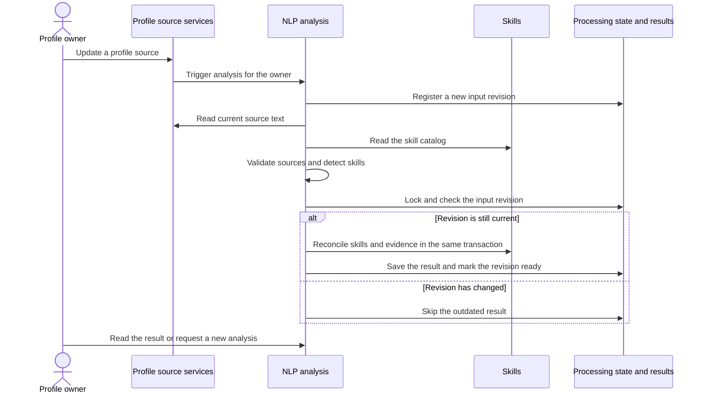

# Profile skills analysis (NLP)

The NLP module detects catalog skills from the professional headline and description, work experience, education, certifications and the current CV. It associates each result with the profile records that support it. Skills owns reconciliation and verification, and Radar owns published scores.

| Endpoint | Behavior |
| --- | --- |
| `GET /profile/me/skills/analysis` | Reads the authenticated owner's stored skills and processing status. |
| `POST /profile/me/skills/analysis` | Runs the analysis for the current input revision and returns the resulting snapshot. |

## Business rules and dependencies

- Profile, Work Experience, Education, Certifications and Radar Evidence provide the current sources. NLP validates those sources and matches them against the Skills catalog.
- Skills reconciles the detections with stored evidence and applies verification rules. Radar uses the resulting verified skills to publish scores.
- Only the current input revision can replace a stored result. Incomplete or failed analysis keeps the last saved skills available while the status indicates the current processing state.

## Analysis flow

## Sprint History

### Sprint 3

- Changes to profile sources register a new input revision. Analysis validates source text, matches it against the skill catalog, and reconciles detected skills and evidence through the Skills module.
- The result is written only if its input revision is still current. A successful result sets the state to `ready`; clients can read `pending` or `error` while the last saved skills remain available.
- Radar uses verified evidence to publish scores. The simulation can award the relevance bonus to eligible pending skills only when the processed revision matches the current input revision and the analysis is ready.
- The profile lists detected skills separately from manually entered skills. Updating a source triggers reconciliation, and the user can also run it again from the profile.

See [Radar integration](../radar-integration/README.md) for publication and [Radar chart](../radar-chart/README.md#mentors-by-area-and-score-simulation) for the simulation.
