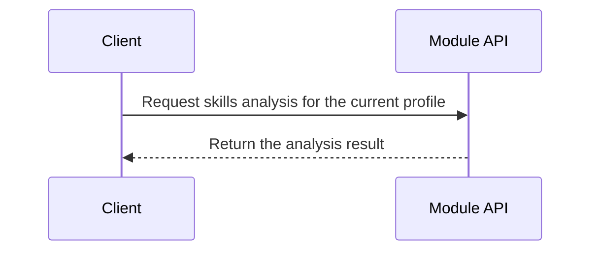

# Profile skills analysis

The backend exposes retrieval and execution of skills analysis for the signed-in profile.

## Rules and dependencies

The profile analysis relies on the profile context and the skills vocabulary. The endpoint distinguishes retrieving analysis from requesting it.

## HTTP contract

- `GET /profile/me/skills/analysis`
- `POST /profile/me/skills/analysis`

## Main flow

## Sprint History

### Sprint 3

The backend exposes retrieval and execution of skills analysis for the signed-in profile.
