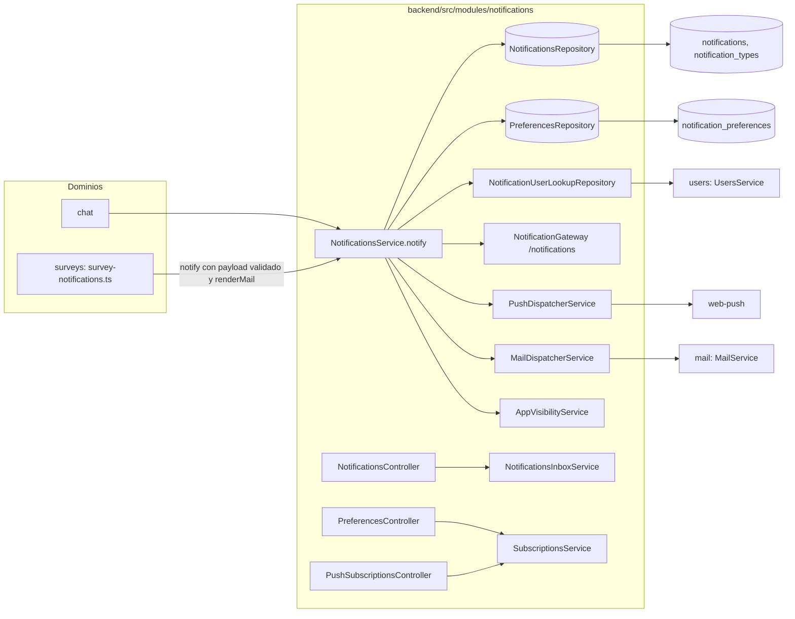
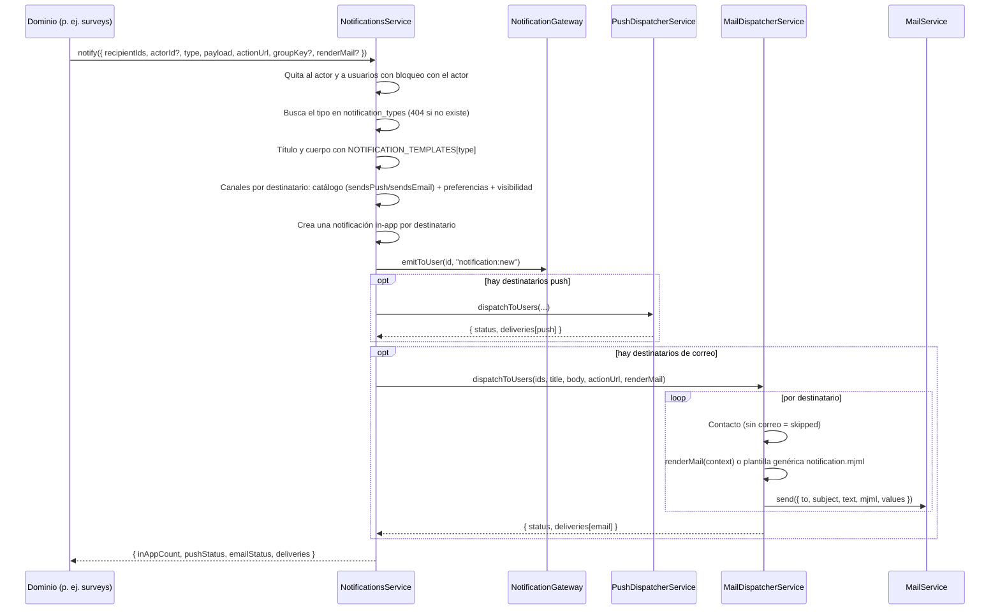

# Notifications (infraestructura central de notificaciones)

## Propósito

El módulo `notifications` es la infraestructura central para avisar a los usuarios. Los dominios llaman a `NotificationsService.notify()` con un tipo, destinatarios y un payload; el módulo guarda la notificación in-app, la emite en tiempo real por WebSocket y la despacha por push (Web Push/VAPID) y por correo según el catálogo de tipos y las preferencias de cada destinatario. Devuelve el estado de cada canal y el resultado por destinatario para que el dominio llamador decida qué mostrar.

También expone la bandeja de notificaciones, las preferencias de canal y el registro de suscripciones push.

## Arquitectura

## Flujos clave

### Envío de una notificación

## Reglas de negocio

- **Destinatarios.** El actor nunca se notifica a sí mismo. Si hay actor, se excluyen los destinatarios con bloqueo entre ambos. Sin destinatarios válidos devuelve todo `skipped` sin escribir nada.
- **Catálogo.** Cada `NotificationType` debe existir en `notification_types`; sus columnas `sends_push` y `sends_email` habilitan cada canal. La semilla del catálogo hace upsert por `code`, así que actualiza los canales de tipos existentes.
- **Preferencias.** Sin preferencia guardada: push desactivado y correo activado. Push y correo no pueden activarse a la vez (`PUT /notifications/preferences`).
- **Push.** Solo si el tipo lo permite, el usuario lo activó y la app no está visible para ese usuario (`visibility:changed` por WebSocket). Se omiten las suscripciones con user agent de escritorio (solo móviles o sin user agent). Título y cuerpo se truncan. Las suscripciones que responden 404/410 se eliminan.
- **Correo.** El dominio puede pasar `renderMail(context)`; recibe `recipientName` y `actionUrl` y devuelve `mjml`, `subject`, `text` y `values`. Sin `renderMail` se usa la plantilla genérica `mail/mjml/notification.mjml`, que se carga una sola vez por envío.
- **Resultado.** Cada canal se resume como `sent` (todo enviado), `partial`, `failed` o `skipped`. `deliveries` trae `{ recipientId, channel: 'push' | 'email', status: 'sent' | 'failed' | 'skipped' }`. Un fallo crítico de un despachador marca su canal como `failed` sin cancelar los demás.
- **Notificaciones de encuestas.** `SURVEY_REMINDER` (push y correo), `SURVEY_CLOSING_SOON`, `SURVEY_CLOSED` y `SURVEY_VARIATION_ALERT` (solo correo). Sus payloads se validan con Zod y sus correos se renderizan en `backend/src/modules/surveys/notification/`; `notifications` solo define título y cuerpo in-app.

## Endpoints

### Expuestos

| Método | Ruta | Descripción |
| --- | --- | --- |
| GET | `/notifications?page&limit` | Bandeja paginada (limit 1–100, por defecto 10) |
| GET | `/notifications/unread-count` | Cantidad de no leídas |
| PATCH | `/notifications/:id/read` | Marca una como leída |
| PATCH | `/notifications/read-all` | Marca todas como leídas |
| GET | `/notifications/preferences` | Preferencias de canal |
| PUT | `/notifications/preferences` | Actualiza `{ pushEnabled, emailEnabled, inAppEnabled }` |
| GET | `/push/public-key` | Clave pública VAPID |
| POST | `/push/subscriptions` | Registra una suscripción push |
| DELETE | `/push/subscriptions` | Elimina una suscripción push |
| WS | namespace `/notifications` (path `/api/socket.io`) | Evento `notification:new`; mensaje `visibility:changed` |

Todos requieren JWT (cualquier rol). El WebSocket autentica con `handshake.auth.token`.

### Servicio exportado

`NotificationsService.notify(request: NotifyRequest): Promise<NotifyResult>` y `SubscriptionsService`. Consumidores actuales: chat y [surveys](../surveys/README.md).

## Dependencias

| Dirección | Módulo | Uso |
| --- | --- | --- |
| Usa | [mail](../mail/README.md) | `MailService.send` y helpers de carga de plantillas MJML |
| Usa | [users](../users/README.md) | `findEmailById`, `findContactById` (nombre y correo del destinatario) |
| Usa | auth | Sesión para autenticar el WebSocket |
| Usado por | chat, [surveys](../surveys/README.md) | Envío de notificaciones |

## Datos

Tablas `notifications`, `notification_types`, `notification_preferences` y `push_subscriptions` (ver [backend/prisma/README.md](../../backend/prisma/README.md)). En el Sprint 3 el catálogo incorpora `SURVEY_REMINDER`, `SURVEY_CLOSING_SOON`, `SURVEY_CLOSED` y `SURVEY_VARIATION_ALERT`.

## Sprint History

### Sprint 3

- `notify()` devuelve el detalle por destinatario y canal (`deliveries`) además del estado agregado; push y correo informan `sent`, `partial`, `failed` o `skipped`.
- El correo admite contenido propio del dominio mediante `renderMail` (plantilla MJML por URL, asunto, texto y valores) con nombre del destinatario.
- Nuevos tipos de notificación de encuestas en el catálogo; la semilla del catálogo pasa a upsert.
- Los contratos de las notificaciones de encuestas (payloads Zod, correos y MJML) se ubican en el dominio surveys.
