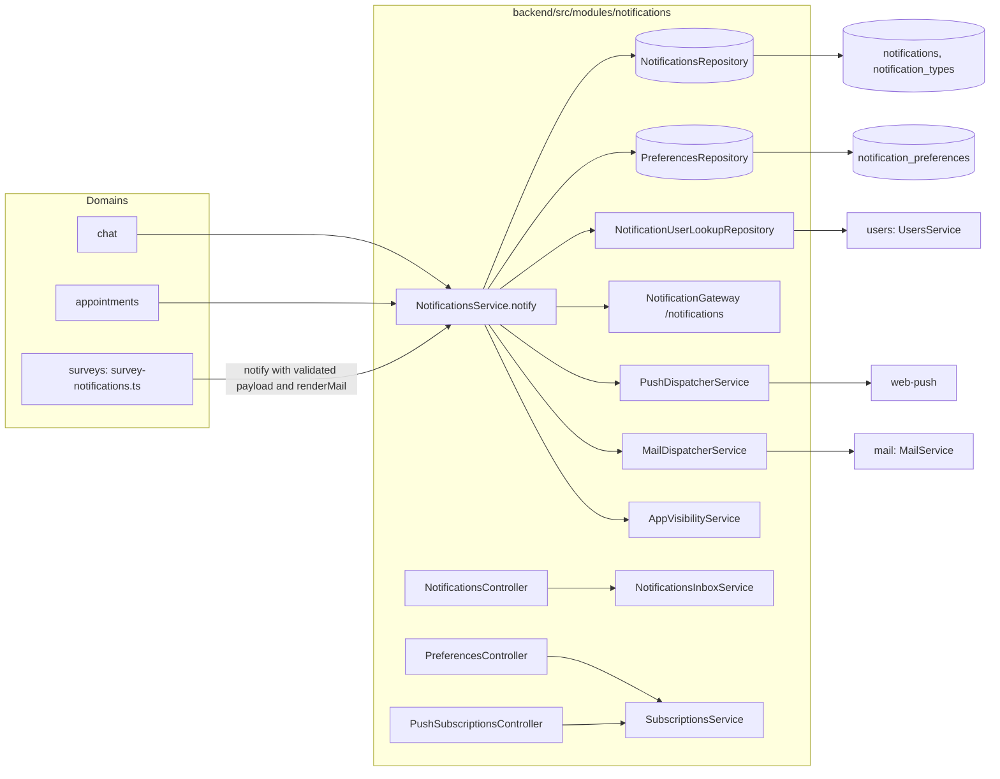
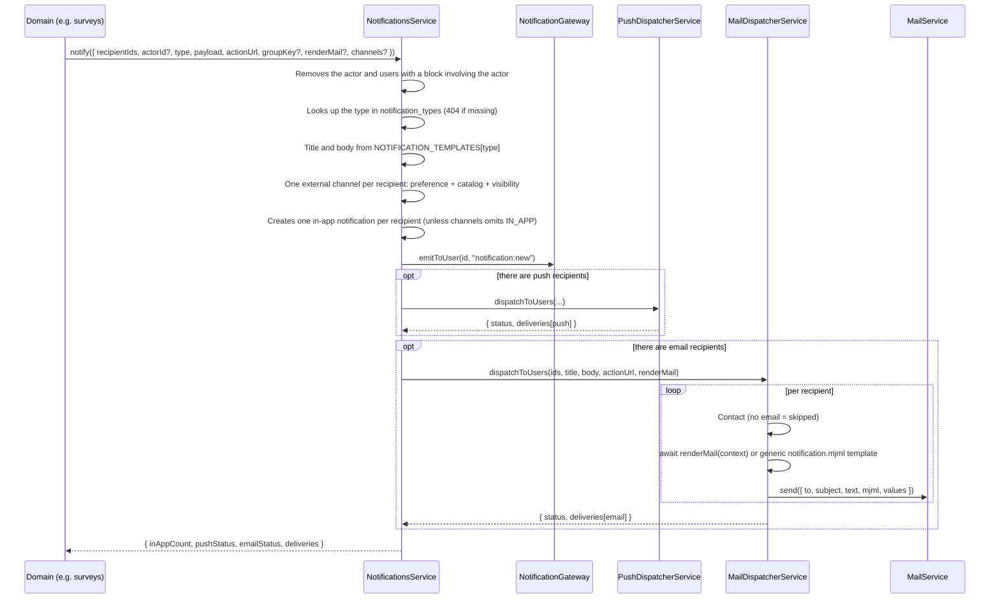
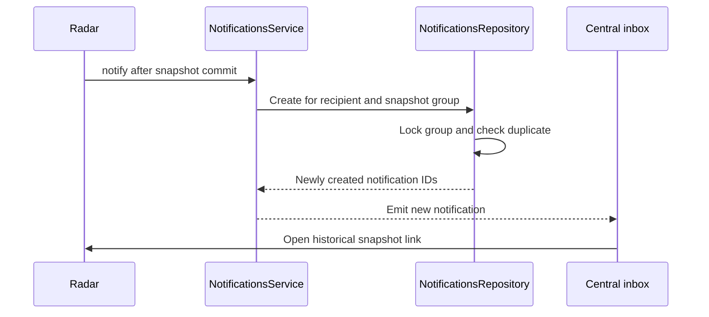
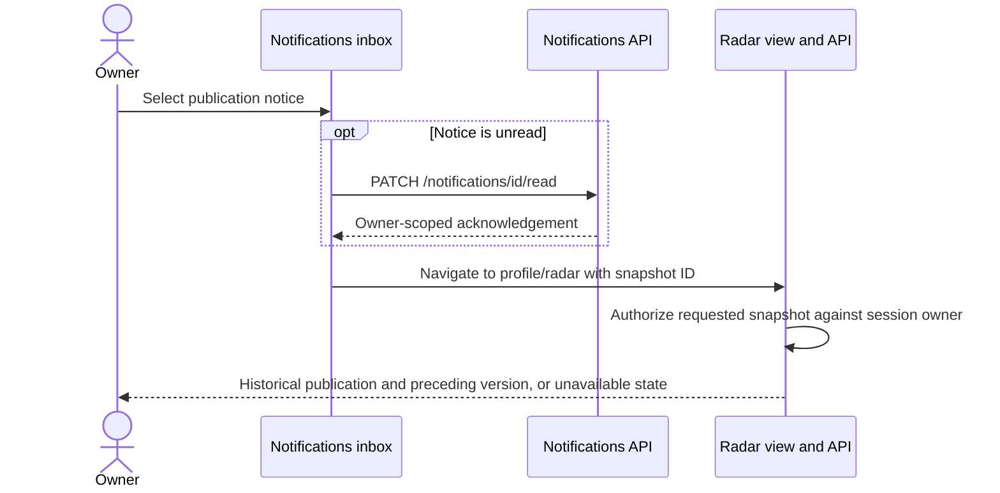

# Notifications (central notification infrastructure)

## Purpose

The `notifications` module is the central infrastructure for alerting users. Domains call `NotificationsService.notify()` with a type, recipients and a payload; the module stores the in-app notification, emits it in real time over WebSocket, and dispatches it by push (Web Push/VAPID) and by email according to the type catalog and each recipient's preferences. It returns the status of each channel and the per-recipient result so the calling domain can decide what to show.

It also exposes the notification inbox, the channel preferences and the push subscription registry.

## Architecture

## Key flows

### Sending a notification

## Business rules

- **Recipients.** The actor is never notified about their own action. If there is an actor, recipients with a block between them and the actor are excluded. With no valid recipients it returns everything as `skipped` without writing anything.
- **Catalog.** Every `NotificationType` must exist in `notification_types`; its `sends_push` and `sends_email` columns enable each channel. The catalog seed upserts by `code`, so it updates the channels of existing types.
- **Preferences.** Each recipient receives at most one external channel, resolved by `resolveNotificationChannel`: push if `pushEnabled`, otherwise email if `emailEnabled`, otherwise none. With no saved preference the channel is email. Older rows that have both push and email enabled resolve to push only. The in-app notification does not depend on this choice.
- **Requested channels.** `notify()` accepts an optional `channels` list (`IN_APP`, `PUSH`, `EMAIL`) to deliver only those channels, for example to retry the one that failed. Without it every channel is considered, so the in-app notification is always created unless `IN_APP` is omitted.
- **Chat and email.** `CHAT_MESSAGE` and `CHAT_GROUP_MESSAGE` never go out by email, even if the catalog enables email for them.
- **Push.** Only if the type allows it, the user enabled it, and the app is not visible for that user (`visibility:changed` over WebSocket). Subscriptions with a desktop user agent are skipped (mobile or no user agent only). Title and body are truncated to 100 characters. Notifications are sent with a 24-hour TTL and `urgency: high` so they arrive with the app closed; `groupKey` becomes the notification tag on the device. Subscriptions that respond 404/410 are deleted.
- **Push subscriptions.** `POST /push/subscriptions` upserts by endpoint and always assigns the endpoint to the authenticated user, so a device used by a new account stops delivering to the previous one.
- **Email.** The domain can pass `renderMail(context)` in the request itself (`NotifyRequest.renderMail`, type `NotificationMailRenderer`); the `NOTIFICATION_TEMPLATES` catalog only defines the in-app title and body. `renderMail` receives `recipientName` and `actionUrl` and returns a promise with `mjml`, `subject`, `text` and `values`, so the domain can read its own `.mjml` template with `loadMailTemplate`. Without `renderMail`, the generic `mail/mjml/notification.mjml` template is used, loaded only once per send; title and body are truncated and the "Ver en UMSSY" button gets an absolute link built with the shared `frontendBaseUrl()` from the mail module (`FRONTEND_URL`, otherwise the first `CORS_ORIGIN`). Links to another origin are replaced by the frontend home.
- **Result.** Each channel is summarized as `sent` (everything sent), `partial`, `failed` or `skipped`. `deliveries` contains `{ recipientId, channel: 'push' | 'email', status: 'sent' | 'failed' | 'skipped' }`. A critical failure in one dispatcher marks its channel as `failed` without cancelling the others.
- **Survey notifications.** `SURVEY_PUBLISHED` and `SURVEY_REMINDER` (push and email), `SURVEY_CLOSING_SOON`, `SURVEY_CLOSED` and `SURVEY_VARIATION_ALERT` (email only). Their payloads are validated with Zod and their emails are rendered in `backend/src/modules/surveys/notification/`; `notifications` only defines the in-app title and body.

## Endpoints

### Exposed

| Method | Route                                              | Description                                            |
| ------ | -------------------------------------------------- | ------------------------------------------------------ |
| GET    | `/notifications?page&limit`                        | Paginated inbox (limit 1–100, default 10)              |
| GET    | `/notifications/unread-count`                      | Number of unread notifications                         |
| PATCH  | `/notifications/:id/read`                          | Marks one as read                                      |
| PATCH  | `/notifications/read-all`                          | Marks all as read                                      |
| GET    | `/notifications/preferences`                       | Channel preferences                                    |
| PUT    | `/notifications/preferences`                       | Updates `{ pushEnabled, emailEnabled, inAppEnabled }`  |
| GET    | `/push/public-key`                                 | VAPID public key                                       |
| POST   | `/push/subscriptions`                              | Registers a push subscription                          |
| DELETE | `/push/subscriptions`                              | Deletes a push subscription                            |
| WS     | namespace `/notifications` (path `/api/socket.io`) | `notification:new` event; `visibility:changed` message |

All require JWT (any role). The WebSocket authenticates with `handshake.auth.token`.

### Exported service

`NotificationsService.notify(request: NotifyRequest): Promise<NotifyResult>` and `SubscriptionsService`. Current consumers: [chat](../chat/README.md), [appointments](../appointments/README.md), [surveys](../surveys/README.md), [mentors](../mentors/README.md), and [radar-integration](../radar-integration/README.md).

## Dependencies

| Direction | Module                                                                                     | Usage                                                                              |
| --------- | ------------------------------------------------------------------------------------------ | ---------------------------------------------------------------------------------- |
| Uses      | [mail](../mail/README.md)                                                                  | `MailService.send`, `loadMailTemplate('notification')` and `frontendBaseUrl()` for the generic email |
| Uses      | [users](../users/README.md)                                                                | `findEmailById`, `findContactById` (recipient name and email)                      |
| Uses      | auth                                                                                       | Session to authenticate the WebSocket                                              |
| Used by   | [chat](../chat/README.md), [appointments](../appointments/README.md), [surveys](../surveys/README.md), [mentors](../mentors/README.md), [radar-integration](../radar-integration/README.md) | Sending domain notifications |

## Data

Tables `notifications`, `notification_types`, `notification_preferences` and `push_subscriptions` (see [backend/prisma/README.md](../../backend/prisma/README.md)). In Sprint 3 the catalog adds `SURVEY_REMINDER`, `SURVEY_CLOSING_SOON`, `SURVEY_CLOSED` and `SURVEY_VARIATION_ALERT`.

## Frontend integration

The frontend does not call `notify()`: the domain that owns the event does. Users choose their channel in **Perfil → Configuración** (see [profile](../profile/README.md)); `PushSubscriptionSync` registers the device subscription again after sign in when the saved channel is push. For surveys, the backoffice receives the per-channel result through `POST /surveys/:id/reminders` (`SendSurveyReminderDialog` shows delivered and failed counts based on `deliveries`), and the `actionUrl` of each notification points to frontend routes: `/notifications?filter=SURVEYS` for the publication notice, `/surveys/:id` for reminders and `/backoffice/surveys/statistics/:id` for the creator.

### Inbox extension points

The inbox stays owned by this module; other domains can add content to it without changing its behavior:

| Extension point | Consumer | Use |
| --- | --- | --- |
| `NotificationsView` optional `filterSections` prop (`Partial<Record<NotificationInboxFilter, ReactNode>>`) | [surveys](../surveys/README.md) | `/notifications` passes `{ SURVEYS: <SurveyNotificationsSection /> }`, rendered above the history only when that filter is active, using the same card and group header styles as `NotificationItem`. Without the prop the view is unchanged |
| Sidebar sub-item badges (`AppShell` `sidebarItemBadges`, matched by label) | [surveys](../surveys/README.md) | `PendingSurveysBadge` on the "Notificaciones de Encuestas" sub-item |

The other filters, the notification list, read state and link resolution are not affected.

## Sprint History

### Sprint 3

- `notify()` returns the per-recipient, per-channel detail (`deliveries`) in addition to the aggregated status; push and email report `sent`, `partial`, `failed` or `skipped`.
- Email supports domain-specific content through an async `renderMail` (MJML content, subject, text and values) with the recipient's name.
- New survey notification types in the catalog; the catalog seed switches to upsert.
- The survey notification contracts (Zod payloads, emails and MJML) live in the surveys domain.
- One external channel per recipient, with push taking precedence for older rows that enable both channels.
- Chat messages are excluded from email; the generic email shows a "Ver en UMSSY" button with an absolute link from the shared mail resolver.
- Optional `channels` in `notify()` to deliver or retry specific channels.
- Push is sent with TTL and high urgency; push subscriptions are reassigned to the account that registers them.
- Optional `filterSections` slot in `NotificationsView` and sub-item badges in the sidebar, so surveys shows its list and pending count inside the "Notificaciones de Encuestas" filter (single inbox).

- Central publication notices retain the exact Radar snapshot reference and support historical navigation.
- Concurrent duplicate prevention per recipient and snapshot, with central ownership of listing and read state.
- Mentor slot offers use `hasGroupedNotification` as a durable preflight for `mentor-slot-offer:<offerId>` and avoid routine repeated `notify()` calls. Recipient/type/group creation is still serialized as the race-safe second defense, so concurrent workers receive at most one newly created recipient to dispatch.

## Radar publication integration

Radar calls `NotificationsService.notify` only after its snapshot transaction commits. The request uses RADAR_PUBLISHED, a version and publication timestamp payload, `groupKey=radar:<snapshotId>` and `/profile/radar?snapshot=<snapshotId>`. Prisma generates the notification ID. Radar does not write notification tables directly.

`NotificationsRepository.createMany` serializes radar group creation per recipient using a transaction advisory lock, checks the recipient/type/group combination and skips existing notices. Only newly created recipients receive socket, push or email delivery. Other notification creation keeps the existing bulk path. The central inbox owns listing and marking notices read; `NotificationsInboxService.findByType` also supports the compatibility radar endpoints. Radar owns historical snapshot authorization.

### Opening a radar publication from the inbox

The inbox owns listing, unread counts and read acknowledgement. Selecting an unread publication notice calls `PATCH /notifications/:id/read` and navigates to its stored `/profile/radar?snapshot=<snapshotId>` link. An already-read notice can be opened again. The Radar historical endpoint checks the authenticated owner independently, so knowing a snapshot ID does not grant access.

The notice and snapshot identifiers serve different purposes: `notification.id` identifies inbox state; `snapshotId` identifies an immutable Radar publication. The body includes the published version, while the link/group key preserves the exact snapshot. This is separate from a document verification's `noticeRead` acknowledgement in the CV dashboard.

Delivery is attempted after the snapshot commits. A validation or dispatcher failure does not roll back the publication; Radar logs a failed notify call. The current integration has no automatic notification retry. Channel preferences and catalog flags still apply, and only newly created recipients receive socket, push and email delivery. The shared service retains per-recipient `deliveries` and optional domain email rendering when filtering duplicates.

The radar publication payload is validated before dispatch with `radarPublishedPayloadSchema` owned by the producing Radar domain at `radar-integration/notification/radar-published-payload.schema.ts`. `radarVersion` must be a positive integer string and `publishedAt` an ISO datetime; unknown fields are rejected. Validation errors are handled with other post-commit delivery failures and never revert the snapshot.
