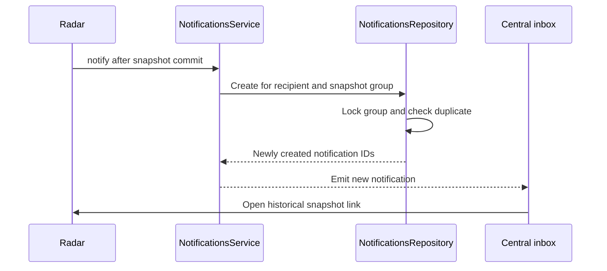

## Sprint History

### Sprint 3

## Radar publication integration

Radar calls `NotificationsService.notify` only after its snapshot transaction commits. The request uses RADAR_PUBLISHED, a version and publication timestamp payload, `groupKey=radar:<snapshotId>` and `/profile/radar?snapshot=<snapshotId>`. Prisma generates the notification ID. Radar does not write notification tables directly.

`NotificationsRepository.createMany` serializes radar group creation per recipient using a transaction advisory lock, checks the recipient/type/group combination and skips existing notices. Only newly created recipients receive socket, push or email delivery. Other notification creation keeps the existing bulk path. The central inbox owns listing and marking notices read; `NotificationsInboxService.findByType` also supports the compatibility radar endpoints. Radar owns historical snapshot authorization.

### Sprint 3 integration updates

- Central creation and inbox ownership for radar publication notices.
- Concurrent duplicate prevention per recipient and snapshot, preserving historical navigation.

The radar publication payload is validated before dispatch with `radarPublishedPayloadSchema` owned by the producing Radar domain at `radar-integration/notification/radar-published-payload.schema.ts`. `radarVersion` must be a positive integer string and `publishedAt` an ISO datetime; unknown fields are rejected. Validation errors are handled with other post-commit delivery failures and never revert the snapshot.
