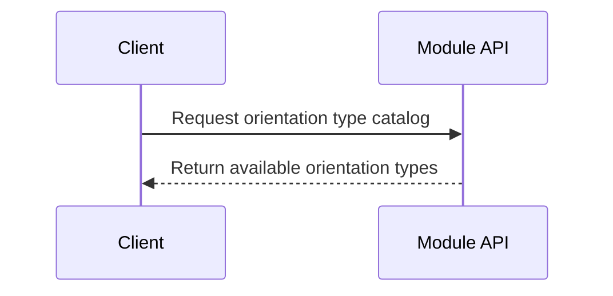

# Orientation types

This backend catalog serves the types of orientation used by the mentorship flow.

## Rules and dependencies

The endpoint reads shared catalog records. Mentorship clients use the identifiers when working with orientation selections.

## HTTP contract

- `GET /orientation-types`

## Main flow

## Sprint History

### Sprint 3

This backend catalog serves the types of orientation used by the mentorship flow.
