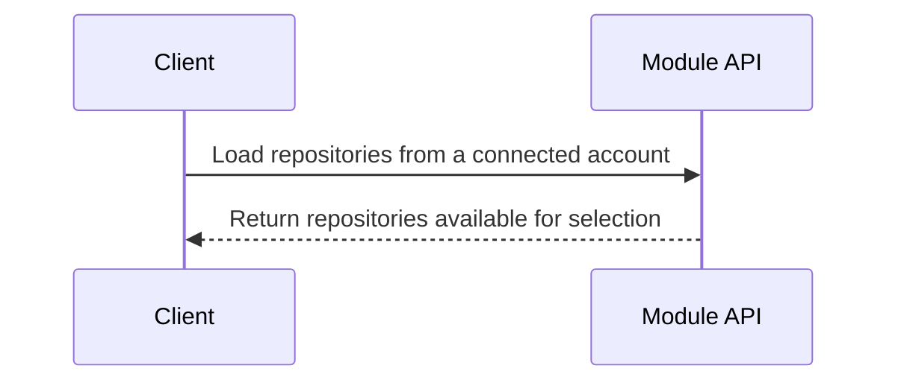
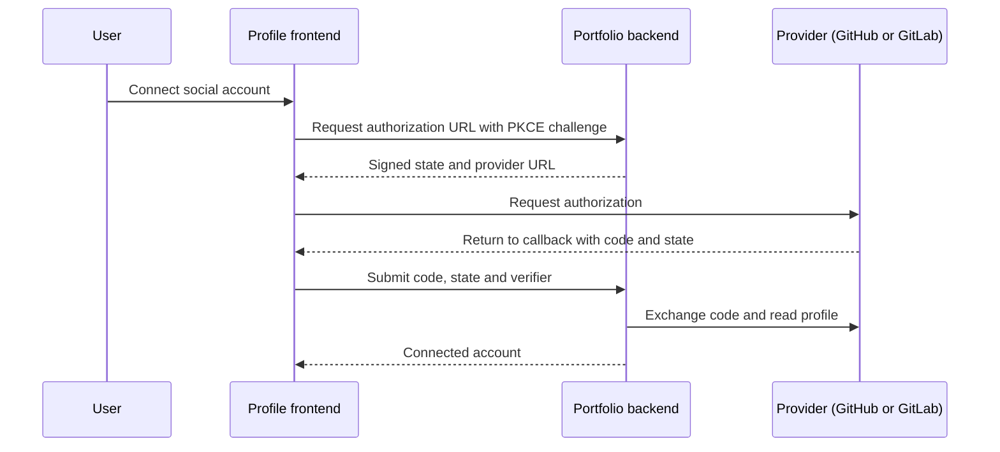

# Portfolio

Profile owners connect a code-hosting account, browse repositories, select projects and synchronize their portfolio.

## Rules and dependencies

OAuth is provider-specific. The portfolio API handles account association, repository access and project persistence for the signed-in profile.

## HTTP contract

- `GET and PUT /profile/portfolio/projects`
- `POST /profile/portfolio/projects/sync`
- `GET /profile/portfolio/accounts`
- `DELETE /profile/portfolio/accounts/:provider`
- `GET /profile/portfolio/oauth/:provider/url`
- `POST /profile/portfolio/oauth/:provider/callback`
- `GET /profile/portfolio/repositories`

## Main flow

## Social OAuth (GitHub and GitLab)

Both GitHub and GitLab use an authorization code flow with S256 PKCE. The frontend requests an authorization URL from `GET /profile/portfolio/oauth/:provider/url` (where `:provider` is `github` or `gitlab`) with an S256 PKCE `challenge`. It stores the pending state and verifier in session storage through the shared storage service before redirecting.

Each provider redirects back to its own frontend callback route:
- `/oauth/github/callback` for GitHub
- `/oauth/gitlab/callback` for GitLab

The frontend extracts the authorization code and state from the URL and submits `code`, `state` and `verifier` to `POST /profile/portfolio/oauth/:provider/callback`. The backend verifies the signed state, authenticated user and PKCE verifier before exchanging the code for an access token. The access token is used transiently to read the profile identity and is not stored; only the connected account identity is saved.

### Configuration

Set credentials in the backend environment:
- GitHub: `GITHUB_CLIENT_ID` and `GITHUB_CLIENT_SECRET`. `GITHUB_CALLBACK_URL` overrides the callback; otherwise the backend derives `/oauth/github/callback` from `FRONTEND_URL` or a single `CORS_ORIGIN`.
- GitLab: `GITLAB_CLIENT_ID` and `GITLAB_CLIENT_SECRET`. `GITLAB_CALLBACK_URL` overrides the callback; otherwise the backend derives `/oauth/gitlab/callback` from `FRONTEND_URL` or a single `CORS_ORIGIN`.

When several CORS origins are configured, set an explicit callback URL for each provider. For local development, register separate OAuth applications with `http://localhost:3000/oauth/github/callback` and `http://localhost:3000/oauth/gitlab/callback`; never commit credentials.

Cancellation, an invalid state, a missing configuration or a provider exchange failure aborts the flow without creating a connected account.

## Sprint History

### Sprint 3

Profile owners connect a code-hosting account, browse repositories, select projects and synchronize their portfolio.
