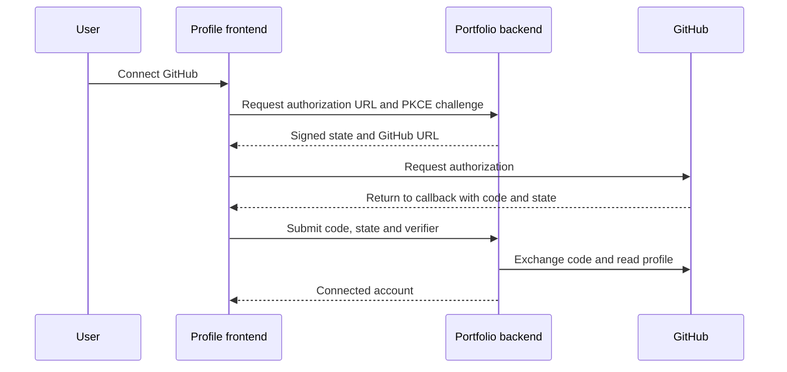

# Portfolio

Authenticated users can connect GitHub and GitLab accounts and select up to six public repositories for their profile. Disconnecting a provider removes its selected projects.

## GitHub OAuth

The frontend obtains a GitHub authorization URL from `GET /profile/portfolio/oauth/github/url` with an S256 PKCE `challenge`. It stores the pending state and verifier in session storage through the shared storage service before navigating. GitHub returns to `/oauth/github/callback`; the frontend submits the code, state and verifier to `POST /profile/portfolio/oauth/github/callback`. The backend verifies the state, authenticated user and verifier before exchanging the code. It uses the GitHub access token temporarily and stores only the connected account identity.

Set `GITHUB_CLIENT_ID` and `GITHUB_CLIENT_SECRET` in the backend environment. GitHub must register the frontend callback URL. `GITHUB_CALLBACK_URL` overrides the callback; otherwise the backend derives `/oauth/github/callback` from `FRONTEND_URL`, or from a single `CORS_ORIGIN`. Set an explicit callback when several origins are configured. For local development, register a separate GitHub OAuth app with `http://localhost:3000/oauth/github/callback`; never commit credentials.

Cancellation, an invalid state, a missing configuration or a provider failure does not create a connected account. GitLab currently uses its existing separate flow.

## Sprint History

### Sprint 3

Connect development accounts and select featured public projects.
