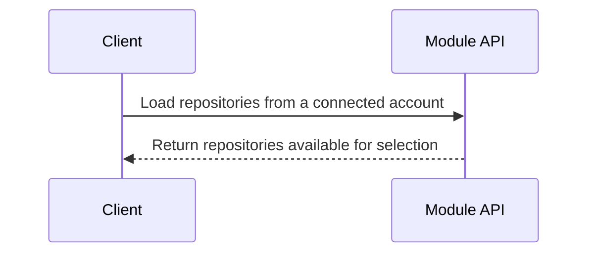

# Portfolio

Profile owners connect a code-hosting account, browse repositories, select projects and synchronize their portfolio.

## Rules and dependencies

OAuth is provider-specific. The portfolio API handles account association, repository access and project persistence for the signed-in profile.

## HTTP contract

- `GET and PUT /profile/portfolio/projects`
- `POST /profile/portfolio/projects/sync`
- `GET /profile/portfolio/accounts`
- `DELETE /profile/portfolio/accounts/:provider`
- `GET /profile/portfolio/oauth/:provider/url`
- `POST /profile/portfolio/oauth/:provider/callback`
- `GET /profile/portfolio/repositories`

## Main flow

## Sprint History

### Sprint 3

Profile owners connect a code-hosting account, browse repositories, select projects and synchronize their portfolio.
