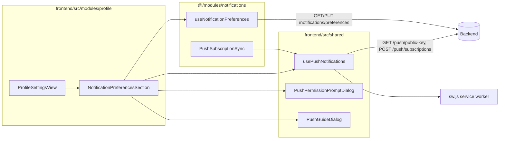
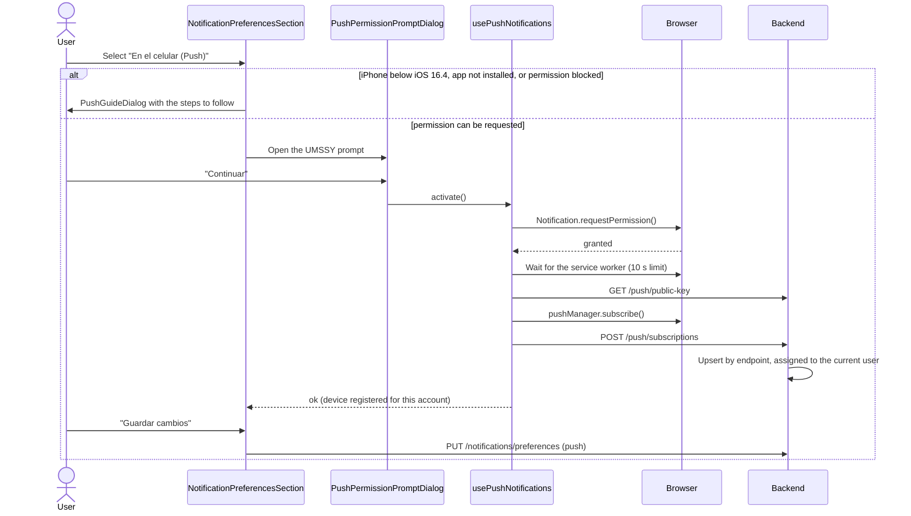

# Profile

## Purpose

The `profile` frontend module (`frontend/src/modules/profile`) shows and edits the user's profile: personal information, presentation, portfolio, completeness guide and settings. This document covers the notification settings in **Perfil → Configuración** (`/profile/settings`), where the user chooses how to receive notifications and activates push on the current device.

## Architecture

The section reads and saves the preference only through `useNotificationPreferences` from the public API of `@/modules/notifications`; the channel mapping belongs to that module.

## Key flows

The profile guide offers navigation to the profile. When a presentation has unsaved changes, the shared navigation guard defers that action and the presentation dialog offers to continue editing, discard, or save before leaving. A failed save keeps the user on the form.

Profile completeness treats a saved manual skill as present, while an NLP-detected skill requires a valid display name and at least one valid evidence reference. This matches the visible NLP skill list. GitHub and GitLab OAuth return through `/oauth/github/callback` and `/oauth/gitlab/callback`; the profile displays the resulting connection status.

### Choosing push on this device

- "Ahora no" closes the prompt and keeps the saved preference.
- If the user blocks or dismisses the native permission, or the subscription fails, the section shows a guide or a message and does not save push.
- Two states are kept apart: the **browser subscription** (`isSubscribed`, read with `pushManager.getSubscription()`) only says that the browser holds a push endpoint; the **account registration** is the `POST /push/subscriptions` that links that endpoint to the signed-in account.
- Push is saved only after the device is registered for the signed-in account. If the browser already has a subscription and the permission is granted, selecting push opens no prompt, but "Guardar cambios" still calls `activate()` to register the endpoint for the current account before `PUT /notifications/preferences`. If that registration fails, push is not saved and the saved preference is kept.

### Activating push on another device

When the saved preference is already push but the current device has no subscription, the section shows "Activar en este dispositivo". It runs the same prompt and `activate()` without saving the preference again.

### Keeping the subscription after signing in again

`PushSubscriptionSync` (mounted in the app providers) runs after sign in. If the saved preference of the signed-in account is push and the permission is already granted, it calls `sync({ token, signal })`, which registers the browser subscription again without asking anything.

- The registration is bound to the session that started it: the request carries that session's token, and the `AbortSignal` cancels it when the session changes (sign out, another account or a new token). A cancelled sync never registers the endpoint for the next account.
- The sync is marked as done for a session only after a successful registration for that same session; a failed or cancelled sync is retried the next time the conditions are met.
- It does not run for accounts whose saved channel is email or in-app.

### Signing out

Signing out tries to delete the current device subscription (`DELETE /push/subscriptions` and `unsubscribe()` in the browser). The sign out waits at most two seconds for it: if the deletion is still pending or fails, the session ends anyway and the deletion may not complete. The endpoint is reassigned to the next account that registers it on that device.

## Business rules

- The user chooses one external channel: "En el celular (Push)", "Solo por correo" or "Solo dentro de la app". The in-app notification bell remains enabled.
- Push is available on mobile browsers. On desktop or unsupported browsers the option is disabled.
- On iPhone, push requires iOS 16.4 or later and UMSSY installed on the home screen; otherwise the corresponding guide is shown.
- A browser subscription that was registered by another account on the same device is reassigned to the account that activates push.

## Endpoints

### Consumed

| Method | Route                          | Usage                                   |
| ------ | ------------------------------ | --------------------------------------- |
| GET    | `/notifications/preferences`   | Saved channel                           |
| PUT    | `/notifications/preferences`   | Saves the chosen channel                |
| GET    | `/push/public-key`             | VAPID key to create the subscription    |
| POST   | `/push/subscriptions`          | Registers the device subscription       |
| DELETE | `/push/subscriptions`          | Removes the device subscription on sign out |

## Dependencies

| Direction | Module                                        | Usage                                                           |
| --------- | --------------------------------------------- | --------------------------------------------------------------- |
| Uses      | [notifications](../notifications/README.md)   | `useNotificationPreferences` and the preference endpoints       |
| Uses      | shared                                        | `usePushNotifications`, push prompt and guide dialogs, `sw.js`  |

## Profile editor

The profile client reads `GET /profile/me`, updates personal information and presentation through their `PATCH /profile/me` subroutes, and loads supported cities through `GET /profile/cities`. Photo retrieval, replacement and deletion use `GET`, `PUT` and `DELETE /profile/me/photo`. The completeness guide reads `GET /profile/completeness` to show remaining requirements.

## Sprint History

### Sprint 3

- Selecting push opens the UMSSY prompt first and the native permission only after "Continuar".
- Guides for blocked permission, iPhone below iOS 16.4 and app not installed on iPhone.
- "Activar en este dispositivo" registers push on a new device without changing the saved preference.
- The device subscription is registered again after signing in, through `PushSubscriptionSync`, bound to the session that started it and cancelled when the session changes.
- Saving push always confirms the registration of the device for the signed-in account, even when the browser already holds a subscription.
- The section uses `useNotificationPreferences` from `@/modules/notifications`; the duplicated profile hook was removed.
