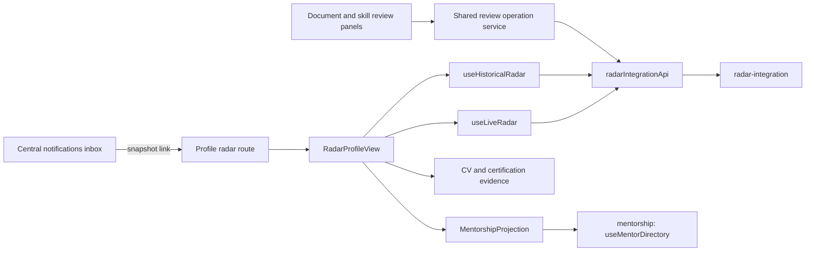
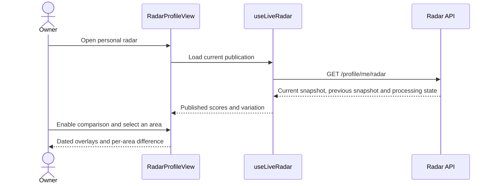
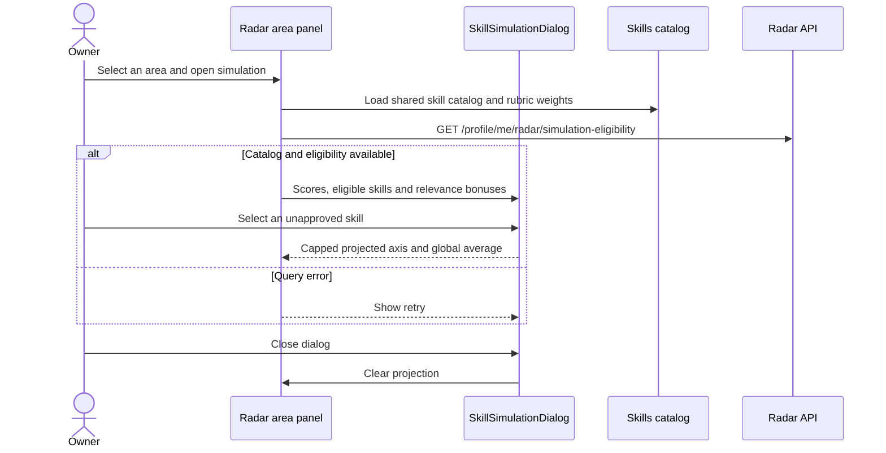
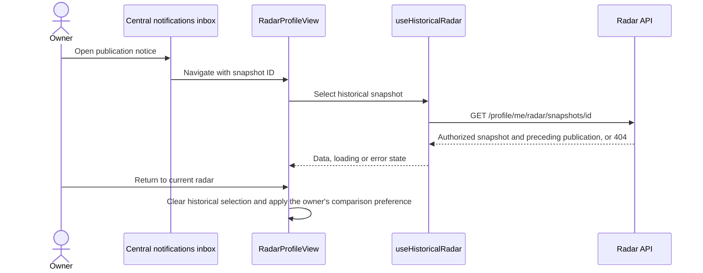

# Affinity radar

## Purpose and responsibilities

`frontend/src/modules/radar-chart` presents the owner's published radar, comparisons with the preceding publication, supporting evidence, historical publications, administrative review and mentorship simulations. [radar-integration](../radar-integration/README.md) owns scoring, persistence, verification and authorization; [notifications](../notifications/README.md) owns publication notices and their read state.

The personal route is `/profile/radar`. Views and hooks use `use client`; the route wraps the view in Suspense for navigation parameters. Scores represent approved evidence on six axes: `desarrollo`, `cloud-devops`, `data-ai`, `qa`, `ciberseguridad` and `gobernanza-ti`.

## Architecture and dependencies

HTTP calls use the centralized `api-client`. The historical hook owns the query key, session scope and loading/error states. Review operation identifiers use shared IndexedDB storage. Data contracts live in individual files under `types/`.

## Current and previous publications

1. `useLiveRadar` loads the authenticated owner's latest publication and its preceding publication through `GET /profile/me/radar`.
2. The view displays scores, average, approved skills, pending skills and publication time. Expanding the professional profile shows the approved skills and their evidence sources.
3. When a preceding publication exists, **Comparar con la anterior** overlays its scores and date on the chart. The change detail shows the selected area's previous score, current score and signed difference, rounded to two decimals. Global variation compares the published averages.
4. The user can select an area from the chart or breakdown and inspect its evidence. Comparison can be disabled without changing either publication.

### Publication states and safeguards

| Condition                                    | Behavior                                                                                                    |
| -------------------------------------------- | ----------------------------------------------------------------------------------------------------------- |
| No publication (`version=0`)                 | Empty state; no invented scores or previous version                                                         |
| One publication                              | Current radar and an explanation that comparison needs another publication                                  |
| Publication with no approved skills          | Six axes at zero with guidance to complete documentation                                                    |
| Analysis or evidence synchronization pending | Keep the valid publication and poll every 1.5 seconds while `processingStatus=pending` or `hasPending=true` |
| Recalculation or connection failure          | Preserve available data, display the failure and offer retry                                                |
| An older response arrives                    | Keep the higher cached publication version                                                                  |
| Session changes during a live request        | Discard that response                                                                                       |

The comparison uses the latest two available publications in the current view. It is not an arbitrary archive picker. A historical link instead compares the requested publication with its own preceding version. Simulated scores never replace either persisted publication.

## Mentors by area and score simulation

Selecting an area exposes **Ver mentores de esta area** and **Simular habilidad**. The directory link passes the area name and `from=radar`; [mentorship](../mentorship/README.md) normalizes the filter and requires available mentors for this entry point.

Opening the simulation loads the shared Skills catalog and calls `GET /profile/me/radar/simulation-eligibility` for the authenticated owner. The dialog groups catalog skills by axis and excludes skills already approved. The eligibility response returns approved skills and the IDs of pending skills that qualify for the relevance bonus when the current analysis is ready.

- Selecting a skill applies its catalog weight to the skill's own axis, capped at 10. The shared rubric gives 1 point per skill and adds 0.5 for high relevance.
- The projected global average uses the projected selected axis and the unchanged scores of the other five axes.
- The optional mentor availability lookup is independent of the projection. The catalog and eligibility must load before a skill can project a gain. Query failures offer retry.
- Closing or unmounting the simulation clears the projection. Simulation does not approve a skill, reserve a mentor or write a score; the estimate does not guarantee a future improvement.

An axis at 6 becomes 7 with the base weight or 7.5 with the relevance bonus. An axis at 9.5 is capped at 10 in both cases.

## Publication notices and historical access

The central inbox opens `/profile/radar?snapshot=<snapshotId>`. `useHistoricalRadar` requests `GET /profile/me/radar/snapshots/:id`, scoped to the current session. The backend authorizes ownership and returns the requested publication with its preceding version. The view displays a historical-version banner and **Volver al radar actual**, which clears the historical selection and returns to the latest publication. Loading and unavailable-publication errors are explicit.

The comparison preference is stored per radar owner for the current browser tab session. The view restores it when the owner reopens the radar or returns from a historical publication. When the displayed publication has a preceding version, the restored setting controls whether the chart overlays that version.

Listing notices and marking them read stay in the Notifications module. Opening a historical snapshot directly does not itself acknowledge a notification. A missing or foreign snapshot returns 404; the client never substitutes another person's data.

## Administrative review and recoverable decisions

Document review lists active versions by filter and offers actions according to their state. The panel previews the backing file before confirmation; temporary file URLs are released when the preview changes or unmounts. Skill review separately lists skills, evidence and approval/rejection/revocation actions. Backend authorization requires `administrativo`; visible controls do not grant access by themselves.

Document approval/rejection and skill decisions use `radar-review-operation.service.ts`. It persists an operation UUID per authenticated administrator, kind, target and decision, queries the matching operation endpoint, and sends a decision only after a 404. Before clearing local intent, it validates operation ID, completed status, kind, target and decision. A failed request or mismatching result retains the UUID for retry. Mount/reconnect recovery checks saved results without issuing new decisions, then refreshes the queues. Document reprocessing and revocation use the document action endpoint without this operation identifier.

The complete verification lifecycle, allowed transitions and response contracts are documented in [radar-integration](../radar-integration/README.md); the owner's result dashboard is documented in [cv](../cv/README.md).

## Consumed endpoints

| Method and path                                       | Purpose                                                     |
| ----------------------------------------------------- | ----------------------------------------------------------- |
| `GET /profile/me/radar`                               | Current and preceding publications with processing state    |
| `GET /profile/me/radar/snapshots/:id`                 | Authorized historical publication and its preceding version |
| `POST /profile/me/radar/recalculations`               | Retry analysis and publication                              |
| `POST /profile/me/radar/cv-rescans`                   | Reanalyze the current CV                                    |
| `GET /mentors/directory`                              | Available mentors for the selected area                     |
| `GET /radar-document-reviews?filter=pending`          | Administrative document queue                               |
| `GET /radar-document-reviews/:id/file`                | Administrative supporting-file preview                      |
| `PATCH /radar-document-reviews/:id`                   | Approve, reject, reprocess or revoke a document             |
| `GET /radar-document-reviews/operations/:operationId` | Recover a document decision                                 |
| `GET /radar-reviews`                                  | Skill and legacy CV review queue                            |
| `PATCH /radar-reviews/:kind/:id`                      | Submit an evidence decision with operation ID               |
| `GET /radar-reviews/operations/:operationId`          | Recover an evidence decision                                |

JSON responses follow `{ statusCode, data, detail, ok }`; supporting files are binary. Owner and administrator permissions are enforced by the backend.

## Validation

Existing tests cover current/previous version preservation, empty/error states, area comparisons, historical navigation and return, mentor availability and score caps, document and skill panels, and review operation recovery. Relevant tests live beside the components, hooks, services and views under `frontend/src/modules/radar-chart`; directory integration tests also live in `frontend/src/modules/mentorship`. Coverage must be measured by Vitest; documentation does not establish a coverage result.

## Sprint History

### Sprint 3

- Previous-publication overlays, dates, average variation and per-area comparison.
- Available mentor search by area and illustrative, capped score simulation.
- Central publication notices, authorized historical access and return to the current radar.
- Document verification results, administrative document/skill review and recoverable decisions.
- Responsive radar interactions and evidence access on mobile.
