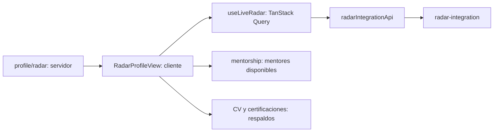
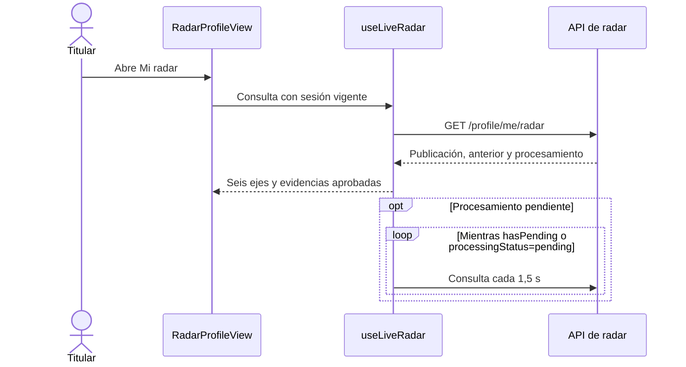

# Radar de afinidad

## Propósito y responsabilidades

`frontend/src/modules/radar-chart` presenta el radar publicado del titular, evidencias, comparación entre publicaciones y simulación con mentoría. Consume [radar-integration](../radar-integration/README.md), que calcula y persiste las puntuaciones. Las rutas solo renderizan vistas; vistas y hooks interactivos declaran `use client`.

## Arquitectura y dependencias

Los servicios HTTP usan `shared/services/api-client`; no guardan tokens ni abren IndexedDB. Las integraciones entre dominios importan el `index.ts` propietario. Cada contrato y props tiene su archivo en `types/`.

## Flujos y reglas de negocio

- Los identificadores persistidos son `desarrollo`, `cloud-devops`, `data-ai`, `qa`, `ciberseguridad` y `gobernanza-ti`; traducir nombres de código no modifica estos contratos.
- La puntuación proviene del backend, no de datos de demostración. Una versión menor no reemplaza una más reciente en caché. Si cambia la sesión, se descarta la respuesta en curso.
- Sin publicación se muestra estado vacío; una publicación sin habilidades aprobadas conserva los seis ejes en cero.
- La comparación usa las dos últimas publicaciones, con sus fechas. Un recálculo pendiente o fallido conserva la última publicación válida y permite reintentar.
- HU2: seleccionar un área consulta el directorio real de mentores disponibles. Con resultados, la simulación estima hasta **+1 punto**, limitado a 10, y calcula el promedio proyectado. Sin mentores o con error no se aplica proyección. Cerrar el diálogo la elimina. Es una estimación ilustrativa que nunca modifica el radar publicado.
- La revisión administrativa consume las APIs autorizadas del backend; ocultar controles no sustituye la autorización del servidor.

## Endpoints consumidos

| Método y ruta | Uso |
| --- | --- |
| `GET /profile/me/radar` | Radar actual, anterior y procesamiento |
| `POST /profile/me/radar/recalculations` | Reintentar análisis y publicación |
| `POST /profile/me/radar/cv-rescans` | Reanalizar CV vigente |
| `GET /radar-document-reviews?filter=pending` | Cola documental administrativa |
| `PATCH /radar-document-reviews/:id` | Resolver, reprocesar o revocar documento |
| `GET /radar-document-reviews/:id/file` | Respaldo administrativo |
| `GET /radar-reviews` | Cola de habilidades y CV |
| `PATCH /radar-reviews/:kind/:id` | Decisión sobre evidencia |

Los JSON siguen `{ statusCode, data, detail, ok }`; los respaldos son binarios. Los permisos y errores se documentan en [radar-integration](../radar-integration/README.md) y Swagger.

## Validación

Las pruebas cubren consulta, conservación de versiones, estados vacíos y de error, comparación, interacción con áreas, simulación y revisión. La cobertura mínima es 80 %; se comprueba con Vitest y no se deduce del número de pruebas aprobadas.

## Sprint History

### Sprint 3

- HU2: mentores disponibles por área y simulación ilustrativa.
- Comparación entre publicaciones y navegación a evidencias.
- HU5: resultado documental y revisión administrativa integrada.
- Adecuación: tipos individuales, identificadores ingleses, exportaciones públicas y estilos estáticos con Tailwind.
