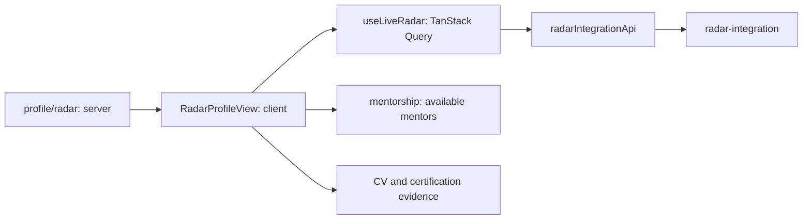
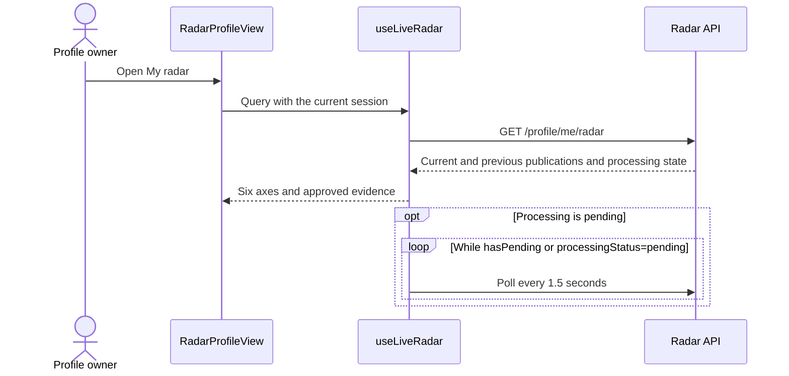

# Affinity radar

## Purpose and responsibilities

`frontend/src/modules/radar-chart` presents the owner's published radar, supporting evidence, comparisons between publications, and mentorship simulations. It consumes [radar-integration](../radar-integration/README.md), which calculates and persists scores. Routes only render views; interactive views and hooks declare `use client`.

## Architecture and dependencies

HTTP services use `shared/services/api-client`; they neither store tokens nor open IndexedDB. Cross-domain integrations import the owning module's `index.ts`. Each contract and props type has its own file in `types/`.

## Flows and business rules

- Persisted identifiers are `desarrollo`, `cloud-devops`, `data-ai`, `qa`, `ciberseguridad`, and `gobernanza-ti`; translating code names does not change these contracts.
- Scores come from the backend, rather than demonstration data. An older version cannot replace a newer cached version. If the session changes, the in-flight response is discarded.
- An empty state appears when there is no publication; a publication without approved skills keeps all six axes at zero.
- Comparisons use the two latest publications and their dates. Pending or failed recalculation preserves the latest valid publication and allows retrying.
- HU2: selecting an area queries the actual directory of available mentors. When results exist, the simulation estimates up to **+1 point**, capped at 10, and calculates the projected average. No projection is applied when there are no mentors or a query fails. Closing the dialog clears the projection. This illustrative estimate never changes the published radar.
- Administrative review consumes authorized backend APIs; hiding controls does not replace server authorization.

## Consumed endpoints

| Method and path | Purpose |
| --- | --- |
| `GET /profile/me/radar` | Current and previous radar publications and processing state |
| `POST /profile/me/radar/recalculations` | Retry analysis and publication |
| `POST /profile/me/radar/cv-rescans` | Reanalyze the current CV |
| `GET /radar-document-reviews?filter=pending` | Administrative document review queue |
| `PATCH /radar-document-reviews/:id` | Decide, reprocess, or revoke a document |
| `GET /radar-document-reviews/:id/file` | Administrative document preview |
| `GET /radar-reviews` | Skill and CV review queue |
| `PATCH /radar-reviews/:kind/:id` | Evidence review decision |

JSON responses follow `{ statusCode, data, detail, ok }`; supporting files are binary responses. Permissions and errors are documented in [radar-integration](../radar-integration/README.md) and Swagger.

## Validation

Tests cover queries, version preservation, empty and error states, comparisons, area interactions, simulation, and review. The minimum coverage is 80%; Vitest measures it independently of the number of passing tests.

## Sprint History

### Sprint 3

- HU2: available mentors by area and illustrative simulation.
- Comparisons between publications and navigation to evidence.
- HU5: document verification results and integrated administrative review.
- Standards alignment: individual types, English identifiers, public exports, and static styles using Tailwind.
