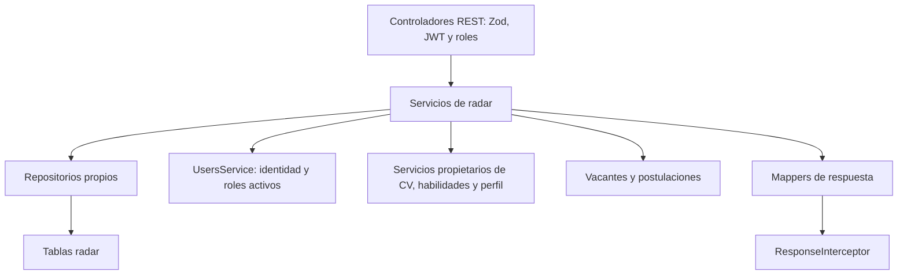
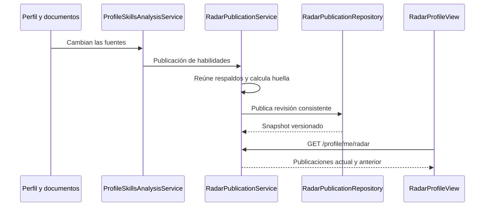

# Integración y publicación del radar

## Propósito y responsabilidades

`backend/src/modules/radar-integration` coordina evidencias verificadas, publicaciones versionadas y afinidad para reclutamiento. Soporta [radar-chart](../radar-chart/README.md) y la verificación que muestra [cv](../cv/README.md). Los controladores validan con Zod y delegan; los servicios concentran reglas; los repositorios acceden a tablas propias; los mappers construyen respuestas envueltas por el interceptor global.

## Arquitectura y dependencias



Las lecturas ajenas pasan por servicios propietarios. `RadarRecruitmentSourcesService` consulta roles a `UsersService`, sin leer `userRole` desde radar. Los servicios no inyectan Prisma. Esquema y migraciones corresponden al equipo de Base de Datos.

## Publicación y puntuación



Se publican habilidades aprobadas con respaldo válido, contando cada habilidad una vez. La rúbrica suma 1 punto por habilidad y 0,5 por alta relevancia, con máximo 10 por eje; el promedio usa los seis ejes. La huella y revisión de fuentes evitan publicaciones inconsistentes. Un fallo conserva el snapshot válido. La respuesta distingue ausencia de publicaciones, publicación en cero, habilidades pendientes y estado NLP.

## HU5: verificación documental

```mermaid
sequenceDiagram
  actor Owner as Titular
  participant Source as CV o certificaciones
  participant Worker as DocumentVerificationService
  participant Review as DocumentReviewService
  participant Radar as RadarPublicationService
  actor Admin as Administrativo
  Owner->>Source: Sube o reemplaza documento
  Source->>Worker: Registra versión activa en cola
  Worker->>Worker: Reclama tarea; ejecuta OCR y NLP
  alt Reglas satisfechas
    Worker->>Worker: Aprueba automáticamente
  else Caso dudoso
    Worker->>Review: Revisión con motivo y respaldo
    Admin->>Review: Consulta y decide
  end
  Worker->>Radar: Actualiza análisis y publicación
  Radar-->>Owner: Resultado y habilidades publicadas
```

El trabajador consulta cada 1,5 s. La reclamación usa `FOR UPDATE SKIP LOCKED`, lease y fecha de reintento; solo finaliza la versión activa con el lease vigente. Lectura sin confianza pasa a revisión; confianza menor a 60 % produce `low_confidence`. Se comprueban duplicados, titular, tipo documental, emisor y habilidades del catálogo con área. Las versiones reemplazadas se conservan y dejan de aportar como activas.

Las decisiones respetan estado y versión; cambios concurrentes devuelven 409. Reconocer lectura requiere titular y estado vigente. `noticeRead` registra lectura del historial, no implementa un canal de envío. El módulo no envía SMTP, Web Push ni Socket.io. Cualquier notificación futura debe usar `NotificationsService.notify()`, plantilla del dominio y tipo acordado con sus mantenedores.

## Reclutamiento y consentimiento

El solicitante necesita rol activo `titulado` o `estudiante` y los tres consentimientos explícitos. Revocar consentimiento general desactiva CV y contacto. El reclutador necesita rol `empresa` y vinculación con la empresa de la vacante. Solo se muestran perfiles con radar publicado y consentimiento vigente; contacto y CV se autorizan por separado. La afinidad ordena candidatos y no decide contrataciones. El retiro y las decisiones finales respetan los estados y se auditan.

## Endpoints

Todos requieren JWT. Titular significa usuario autenticado; los UUID se validan antes del servicio. Las listas son completas, sin paginación. La cola documental admite `filter=pending|approved|rejected|all`, con `pending` predeterminado. Swagger documenta las 24 operaciones, sus parámetros, cuerpos, roles y respuestas.

| Método y ruta | Permiso y resultado |
| --- | --- |
| `GET /profile/me/radar` | Titular: radar actual/anterior |
| `POST /profile/me/radar/recalculations` | Titular: reanálisis y publicación |
| `POST /profile/me/radar/cv-rescans` | Titular: reanalizar CV vigente |
| `GET /radar-reviews` | Administrativo: cola de CV/habilidades |
| `PATCH /radar-reviews/:kind/:id` | Administrativo: approved/rejected/revoked; kind=cv o skill |
| `POST /radar-reviews/cvs/:id/reprocessings` | Administrativo: reprocesar CV |
| `GET /radar-reviews/cvs/:id/file` | Administrativo: PDF y registro de consulta |
| `GET /profile/me/document-verifications` | Titular: historial de versiones |
| `PATCH /profile/me/document-verifications/:id/notification` | Titular: reconocer lectura de estado vigente |
| `GET /profile/me/document-verifications/:id/file` | Titular: respaldo propio |
| `GET /radar-document-reviews` | Administrativo: versiones activas filtradas |
| `PATCH /radar-document-reviews/:id` | Administrativo: approved/rejected/reprocess/revoke |
| `GET /radar-document-reviews/:id/file` | Administrativo: respaldo documental |
| `POST /radar-integration/admin/company-access` | Administrativo: vincular usuario empresa |
| `GET /radar-integration/vacancies` | Sesión: vacantes activas |
| `POST /radar-integration/applications` | Titulado/estudiante: postular con consentimiento |
| `GET /radar-integration/me/applications` | Titulado/estudiante: postulaciones propias |
| `PATCH /radar-integration/me/applications/:id/consents` | Titulado/estudiante: permisos propios |
| `PATCH /radar-integration/me/applications/:id/withdraw` | Titulado/estudiante: retirar postulación |
| `GET /radar-integration/recruiter/vacancies` | Empresa: sus vacantes |
| `GET /radar-integration/recruiter/vacancies/:id/applicants` | Empresa vinculada: afinidad descendente |
| `GET /radar-integration/recruiter/applications/:id/areas/:areaId/evidence` | Empresa vinculada: respaldos aprobados |
| `GET /radar-integration/recruiter/applications/:id/cv` | Empresa vinculada y consentimiento: PDF |
| `PATCH /radar-integration/recruiter/applications/:id` | Empresa vinculada: hired/rejected |

JSON correcto: `{ statusCode, data, detail, ok: true }`; POST usa 201, GET/PATCH 200. Errores: `{ statusCode, code, detail, data, ok: false }`. Se documentan 400 para entradas, 401 para sesión, 403 para permisos/consentimiento, 404 para recursos no disponibles, 409 para conflicto y 500 para fallo interno donde aplican. Las descargas envían bytes sin envoltura JSON y `Content-Disposition: inline`; los respaldos conservan su MIME.

## Datos y validación

Modelos y relaciones: [backend/prisma/README.md](../../backend/prisma/README.md). Diferencias pendientes del estándar de BD: [solicitud al equipo propietario](database-change-request.md). Esta adecuación no modifica esquema ni migraciones.

Las pruebas cubren publicación, procedencia, revisión concurrente, consentimiento, autorización y contratos OpenAPI. Validar con Vitest, ESLint, Oxlint y compilación de backend. La cobertura mínima de 80 % se confirma con el informe de la ejecución correspondiente.

## Sprint History

### Sprint 3

- Publicación versionada, comparación y evidencias aprobadas.
- HU2: áreas de radar y soporte de integración con mentores.
- HU5: verificación OCR/NLP, historial y revisión administrativa.
- Consentimiento y afinidad para reclutamiento.
- Adecuación: contratos `.types.ts`, documentación REST/OpenAPI y roles a través del servicio propietario.
