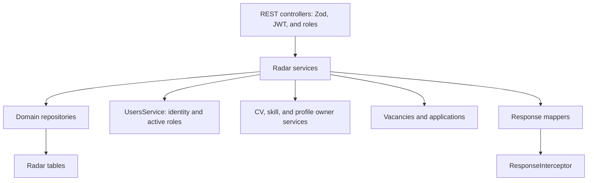
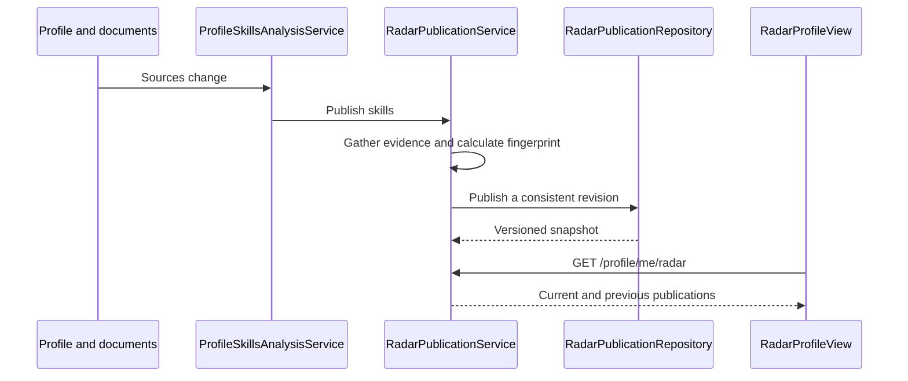
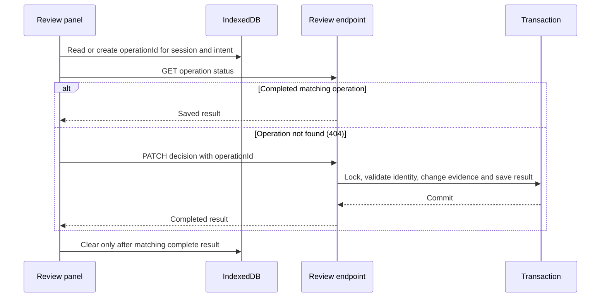
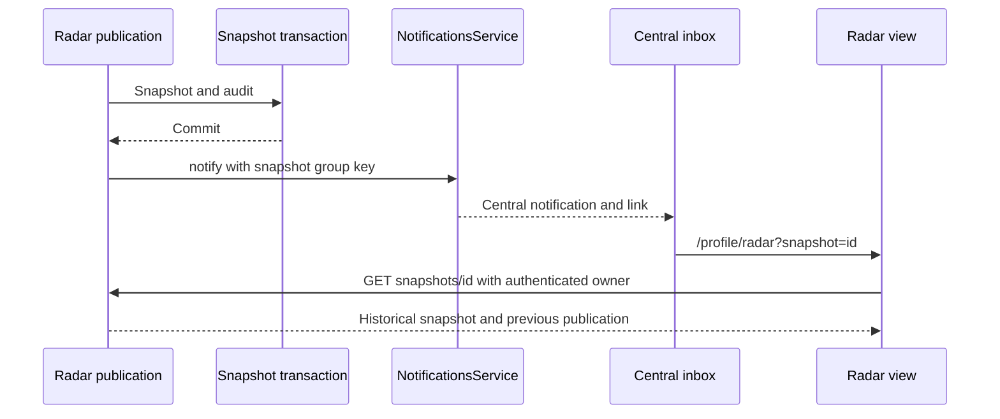

# Radar integration and publication

## Purpose and responsibilities

`backend/src/modules/radar-integration` coordinates verified evidence, versioned publications, and recruitment affinity. It supports [radar-chart](../radar-chart/README.md) and the verification shown by [cv](../cv/README.md). Controllers validate with Zod and delegate; services own business rules; repositories access their own tables; mappers build responses wrapped by the global interceptor.

## Architecture and dependencies



Cross-domain reads use the owning services. `RadarRecruitmentSourcesService` queries roles through `UsersService`, without reading `userRole` directly from radar. Services do not inject Prisma. The Database team owns the schema and migrations.

Certification document mutations obtain active verification IDs through `RadarAuditService` with the caller's `TransactionContext`. The certification service holds its own row lock and validates the expected version before writing; Radar repositories keep verification-table access inside the owning domain.

## Publication and scoring



Only approved skills with valid evidence are published, counting each skill once. The rubric adds 1 point per skill and 0.5 for high relevance, capped at 10 per axis; the average uses all six axes. The fingerprint and source revision prevent inconsistent publications. Failures preserve the valid snapshot. The response distinguishes no publication, a zero-score publication, pending skills, and NLP state.

## Document verification

```mermaid
sequenceDiagram
  actor Owner as Profile owner
  participant Source as CV or certifications
  participant Worker as DocumentVerificationService
  participant Review as DocumentReviewService
  participant Radar as RadarPublicationService
  actor Admin as Administrator
  Owner->>Source: Upload or replace a document
  Source->>Worker: Queue the active version
  Worker->>Worker: Claim job; run OCR and NLP
  alt Rules satisfied
    Worker->>Worker: Approve automatically
  else Uncertain case
    Worker->>Review: Review with reason and supporting file
    Admin->>Review: Inspect and decide
  end
  Worker->>Radar: Update analysis and publication
  Radar-->>Owner: Result and published skills
```

The worker polls every 1.5 seconds. Claims use `FOR UPDATE SKIP LOCKED`, a lease, and a retry date; only the active version with a current lease is finalized. Readings without confidence go to review; confidence below 60% produces `low_confidence`. Checks cover duplicates, owner identity, document type, issuer, and catalog skills with an area. Replaced versions remain in history and stop contributing as active sources.

Decisions respect state and version; concurrent changes return 409. Acknowledging a result requires its owner and current state. `noticeRead` records history acknowledgement, rather than implementing a delivery channel. This module does not send SMTP, Web Push, or Socket.io messages. Publication notifications use `NotificationsService.notify()`, the RADAR_PUBLISHED template and the central inbox.

## Recruitment and consent

Applicants need an active `titulado` or `estudiante` role and all three explicit consents. Revoking general consent disables CV and contact sharing. Recruiters need the `empresa` role and a link to the vacancy's company. Only profiles with a published radar and current consent are shown; contact and CV access are authorized separately. Affinity ranks candidates without making hiring decisions. Withdrawal and final decisions respect application state and are audited.

## Endpoints

All endpoints require JWT. Owner means the authenticated user; UUIDs are validated before services run. Lists are complete and unpaginated. The document queue accepts `filter=pending|approved|rejected|all`, defaulting to `pending`. Swagger documents all 29 operations, their parameters, bodies, roles, and responses.

Error responses reference the shared `#/components/schemas/ApiErrorResponse` schema registered by `documentCommonResponses`, retaining Radar-specific descriptions and examples.

| Method and path                                                            | Permission and result                                      |
| -------------------------------------------------------------------------- | ---------------------------------------------------------- |
| `GET /profile/me/radar`                                                    | Owner: current and previous radar publications             |
| `POST /profile/me/radar/recalculations`                                    | Owner: reanalysis and publication                          |
| `POST /profile/me/radar/cv-rescans`                                        | Owner: reanalyze the current CV                            |
| `GET /radar-reviews`                                                       | Administrator: CV and skill queue                          |
| `PATCH /radar-reviews/:kind/:id`                                           | Administrator: approved/rejected/revoked; kind=cv or skill |
| `POST /radar-reviews/cvs/:id/reprocessings`                                | Administrator: reprocess CV                                |
| `GET /radar-reviews/cvs/:id/file`                                          | Administrator: PDF and access audit                        |
| `GET /profile/me/document-verifications`                                   | Owner: version history                                     |
| `PATCH /profile/me/document-verifications/:id/notification`                | Owner: acknowledge the current result state                |
| `GET /profile/me/document-verifications/:id/file`                          | Owner: supporting file                                     |
| `GET /radar-document-reviews`                                              | Administrator: filtered active versions                    |
| `PATCH /radar-document-reviews/:id`                                        | Administrator: approved/rejected/reprocess/revoke          |
| `GET /radar-document-reviews/:id/file`                                     | Administrator: supporting document                         |
| `POST /radar-integration/admin/company-access`                             | Administrator: link a company user                         |
| `GET /radar-integration/vacancies`                                         | Authenticated session: active vacancies                    |
| `POST /radar-integration/applications`                                     | Titulado/estudiante: apply with consent                    |
| `GET /radar-integration/me/applications`                                   | Titulado/estudiante: owned applications                    |
| `PATCH /radar-integration/me/applications/:id/consents`                    | Titulado/estudiante: owned sharing permissions             |
| `PATCH /radar-integration/me/applications/:id/withdraw`                    | Titulado/estudiante: withdraw an owned application         |
| `GET /radar-integration/recruiter/vacancies`                               | Company user: company vacancies                            |
| `GET /radar-integration/recruiter/vacancies/:id/applicants`                | Linked company user: descending affinity ranking           |
| `GET /radar-integration/recruiter/applications/:id/areas/:areaId/evidence` | Linked company user: approved evidence                     |
| `GET /radar-integration/recruiter/applications/:id/cv`                     | Linked company user with consent: PDF                      |
| `PATCH /radar-integration/recruiter/applications/:id`                      | Linked company user: hired/rejected                        |

Successful JSON: `{ statusCode, data, detail, ok: true }`; POST uses 201, while GET/PATCH use 200. Errors: `{ statusCode, code, detail, data, ok: false }`. Applicable documented statuses are 400 for input, 401 for session, 403 for permission/consent, 404 for unavailable resources, 409 for conflicts, and 500 for internal failure. Downloads send bytes without a JSON envelope and use `Content-Disposition: inline`; supporting files retain their MIME type.

## Data and validation

Models and relationships: [backend/prisma/README.md](../../backend/prisma/README.md). Outstanding database standards differences: [request to the owning team](database-change-request.md). This standards update does not modify the schema or migrations.

Tests cover publication, provenance, concurrent review, consent, authorization, and OpenAPI contracts. Validate with Vitest, ESLint, Oxlint, and the backend build. The minimum coverage of 80% is confirmed by the corresponding execution report.

## Sprint History

### Sprint 3

- Versioned publication, comparisons, and approved evidence.
- Mentorship integration: radar areas and mentor integration support.
- Document verification: OCR/NLP verification, history, and administrative review.
- Consent and recruitment affinity.
- Standards alignment: `.types.ts` contracts, REST/OpenAPI documentation, and roles accessed through the owning service.

## Recoverable review decisions and publication notifications

The frontend persists a UUID in IndexedDB per authenticated administrator, evidence kind, target and decision. `submitRadarReviewDecision` first queries the matching operation endpoint. Only a 404 allows sending a decision. The operation ID, completed status, kind, target and decision must all match before clearing local state. Network errors and conflicting responses retain the UUID for retry; mounting the review panels also recovers completed operations without sending new decisions.

Administrative endpoints require the `administrativo` role. `GET /radar-reviews/operations/:operationId` and `GET /radar-document-reviews/operations/:operationId` return `{ operationId, status: "completed", kind, targetId, decision, changed, userId, completedAt }` inside the standard API envelope. Operations belonging to another administrator or review flow return 404. Reusing an ID with different intent returns 409. `PATCH /radar-document-reviews/:id` validates the complete strict union through `RequestValidationPipe`: approved/rejected require operationId; reprocess/revoke accept only decision. `DocumentReviewDecisionService` coordinates these actions and raises domain conflicts for obsolete versions.

Both decision services share the transaction operation lookup, locking and identity validation. They keep document and skill state changes in their respective domain services; the operation result and audit are saved in the same transaction as the decision.



Publication commits the snapshot and audit before calling `NotificationsService.notify` with RADAR_PUBLISHED, `groupKey=radar:<snapshotId>` and `/profile/radar?snapshot=<snapshotId>`. The notification owner creates IDs and prevents concurrent duplicate publication notices. Delivery failure is logged and does not revert the committed snapshot. There is no automatic notification delivery retry.

The central Notifications inbox owns listing and read state. Radar keeps snapshot queries only. `GET /profile/me/radar/snapshots/:id` returns the historical radar with its previous version and a ready processing state; the query includes the authenticated owner and returns 404 for missing or foreign snapshots. The view shows loading/error status and allows returning to the current radar. Compatibility notification routes delegate to `NotificationsInboxService`.



Dependencies: NotificationsModule provides notification creation, inbox access and read state. The radar frontend uses the central inbox links and the shared operation service. Review contracts live individually in `types/`; semantic destructive styles and `cn()` follow the shared UI conventions.
