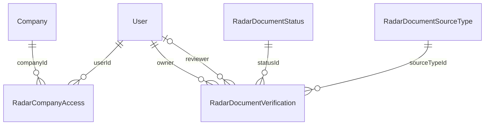

# Radar model standards alignment request

## Document persistence and radar

Type: refactor. Priority: high. Initial estimate: 6 hours, to be confirmed by the Database team. Dependency: data model approval before changing the schema and migrations. Publish using the backend task template and associate the issue with the owning team's board; this file prepares the request and does not create an issue outside its project.

Owner: Database team. This request does not alter the schema or published migrations.

| Model | Current difference | Requested change |
| --- | --- | --- |
| `RadarCompanyAccess` | Composite primary key, no dedicated ID or audit fields; model ignored by Prisma | Add a UUID ID, preserve the pair with `@@unique`, add audit fields and an index starting with `userId`. Review `@@ignore`. |
| `RadarJobApplication` | No `createdAt`/`updatedAt`; textual `state`; `userId` and `decidedBy` lack dedicated indexes; `decider` uses `NoAction` | Confirm whether this legacy model remains active before migrating. If retained, add audit fields, a status catalog, indexes, and a deletion policy consistent with traceability. |
| `Radar*` IDs using `dbgenerated(gen_random_uuid())` | Default differs from the new `@default(uuid())` requirement | Agree on a single mechanism. Do not remove database defaults without adapting SQL INSERT statements that omit IDs. |
| `RadarDocumentVerification` | Audit defaults use `clock_timestamp()` rather than `now()` | Evaluate transactional semantics and version ordering before migrating. Preserve mappings, precision, and `@updatedAt`. |

## Acceptance criteria

- [ ] Confirm ownership and usage of `@@ignore` tables.
- [ ] Preserve data, uniqueness, and relationships.
- [ ] Use UUIDs and appropriate indexes for every foreign key.
- [ ] Apply catalogs, mappings, and explicit deletion behavior.
- [ ] Regenerate Prisma and adapt INSERT statements that depend on defaults.
- [ ] Validate the migration against a temporary database, including publication, consent, and verification flows.
- [ ] Update documentation and obtain review from the owning team.
