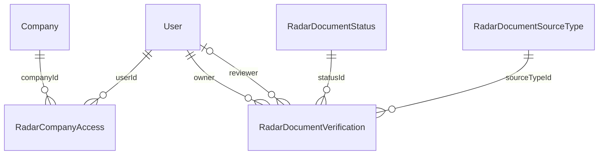

# Solicitud de adecuación de modelos de radar

## Epic #3 - User Story 5: persistencia documental y radar

Tipo: refactor. Prioridad: alta. Estimación inicial: 6 horas, a confirmar por el equipo de Base de Datos. Dependencia: aprobación del modelo de datos antes de modificar esquema y migraciones. Publicar mediante la plantilla de tarea backend y asociar al tablero del equipo propietario; este archivo prepara la solicitud y no crea una issue fuera de su proyecto.

Responsable: equipo de Base de Datos. Esta solicitud no altera esquema ni migraciones publicadas.

| Modelo | Diferencia actual | Cambio solicitado |
| --- | --- | --- |
| `RadarCompanyAccess` | Clave primaria compuesta, sin ID propio ni auditoría; modelo ignorado por Prisma | Añadir ID UUID, conservar el par con `@@unique`, auditoría e índice que comience por `userId`. Revisar `@@ignore`. |
| `RadarJobApplication` | Sin `createdAt`/`updatedAt`; `state` textual; `userId` y `decidedBy` sin índices propios; `decider` con `NoAction` | Confirmar si es legado activo antes de migrar. Si permanece, añadir auditoría, catálogo de estado, índices y política de borrado acorde a trazabilidad. |
| IDs `Radar*` con `dbgenerated(gen_random_uuid())` | Default distinto del literal `@default(uuid())` nuevo | Acordar mecanismo único. No retirar defaults de BD sin adaptar los INSERT SQL que omiten ID. |
| `RadarDocumentVerification` | Auditoría con `clock_timestamp()` en lugar de `now()` | Evaluar semántica transaccional y orden de versiones antes de migrar. Conservar mapas, precisión y `@updatedAt`. |

## Criterios de aceptación

- [ ] Confirmar propiedad y uso de tablas `@@ignore`.
- [ ] Preservar datos, unicidad y relaciones.
- [ ] Usar UUID e índices adecuados en todas las FK.
- [ ] Aplicar catálogos, mapas y acciones de borrado explícitas.
- [ ] Regenerar Prisma y adaptar INSERT dependientes de defaults.
- [ ] Validar migración en BD temporal, publicación, consentimiento y verificación.
- [ ] Actualizar documentación y obtener revisión del equipo propietario.
