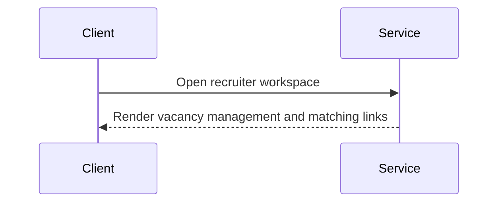

# Recruiter workspace

The recruiter home brings together job offers, vacancy history and candidate matching.

## Rules and dependencies

The workspace delegates offer mutations to job-offers and candidate queries to matching. It does not define its own backend API.

## Main flow

## Sprint History

### Sprint 3

The recruiter home brings together job offers, vacancy history and candidate matching.
