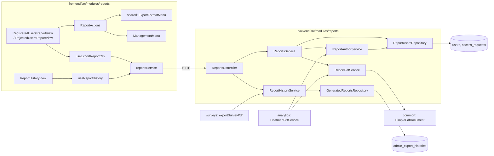
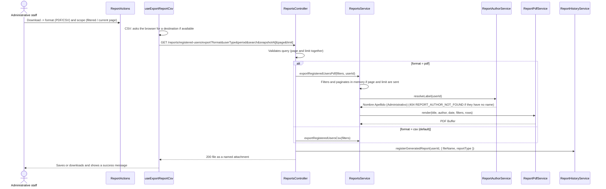

# Reports (administrative reports)

## Purpose

The `reports` module gives administrative staff the accepted and rejected users reports, their CSV and PDF export, and the history of generated reports. It also exposes academic semester utilities and the history to other domains (for example, the survey PDF report), and the PDF renderer and author resolution to analytics (heatmap PDF export).

- Backend: `backend/src/modules/reports` (`ReportsController`, `ReportsService`, `ReportPdfService`, `ReportAuthorService`, `ReportHistoryService`, user and generated report repositories).
- Frontend: `frontend/src/modules/reports` (accepted users, rejected users and history views, download menu with format and scope, academic year menu).

## Functionality

| Feature | Backend | Frontend route |
| --- | --- | --- |
| Paginated and filtered accepted users | `GET /reports/registered-users` | `/backoffice/reports/registered-users` |
| Paginated and filtered rejected users | `GET /reports/rejected-users` | `/backoffice/reports/rejected-users` |
| Export as CSV or PDF, the whole filter or only the current page | `GET /reports/registered-users/export`, `GET /reports/rejected-users/export` | `ReportActions` |
| History of generated reports | `GET /reports/history` | `/backoffice/reports/history` |

## Architecture

## Key flows

### Export a report

## Business rules

- **Access.** The whole controller requires JWT and the `administrativo` role.
- **Filters.** `userType` (role or `ALL`), `period` (`I-AAAA` / `II-AAAA` or `ALL`), `search` and `snapshotAt` (ISO 8601 cutoff date with time zone). `ALL` means no filter.
- **Export scope.** Without `page` or `limit`, the whole filtered result is exported; with both, only that page is exported. Sending only one of the two returns 400.
- **Format.** `format` = `csv` (default) or `pdf`. Both use the same base name (`buildExportFileName`) with a `.csv` or `.pdf` extension.
- **PDF.** Landscape A4 sheet with an institutional header (UMSS, UMSSY), cards for generation date, author (`Nombre Apellido (Administrativo)`) and total records, pills with the applied filters, generation date with `formatBoliviaDateTime` (`DD/MM/AAAA HH:mm`, Bolivia time, shared with the rest of the backend), a table with name, email, user type, document and approval or rejection date, alternating rows, page breaks with a repeated header and a "Página X de Y" footer. With no rows it shows "No hay resultados disponibles para exportar.".
- **Date filter in the PDF.** The academic year is shown as the semester start date (`01/01/AAAA` or `01/07/AAAA`); without an academic year, "Todas las fechas".
- **History.** Each export (CSV or PDF) records the file and its type (`REGISTERED_USERS` or its per-user-type variant, and `REJECTED_USERS`); the survey report records `SURVEY_STATISTICS`.
- **Frontend.** Prevents simultaneous exports, shows the success message for 4 s and an error toast if it fails. The academic year menu lists the academic semesters with the "Todas" option.

## Endpoints

### Exposed

| Method | Path | Query | Response | Errors |
| --- | --- | --- | --- | --- |
| GET | `/reports/registered-users` | `page`, `limit`, `userType`, `period`, `search`, `snapshotAt` | 200 page of accepted users | 400 |
| GET | `/reports/registered-users/export` | Filters + `format` (`csv`/`pdf`), `page` and `limit` optional and together | 200 `text/csv` or `application/pdf` | 400, 404 `REPORT_AUTHOR_NOT_FOUND` (PDF) |
| GET | `/reports/rejected-users` | Same as accepted | 200 page of rejected users | 400 |
| GET | `/reports/rejected-users/export` | Same as accepted | 200 `text/csv` or `application/pdf` | 400, 404 (PDF) |
| GET | `/reports/history` | `page`, `limit`, `reportType`, `search`, `snapshotAt` | 200 page of generated reports | 400 |

All of them require JWT and the `administrativo` role. JSON responses use `{ statusCode, data, detail, ok }`; exports are binary with `Content-Disposition: attachment`.

Swagger (`/docs`) documents each endpoint with `operationId`, Bearer JWT, roles, parameters and constraints taken from the Zod schemas, success examples with the `{ statusCode, ok, detail, data }` envelope, the errors thrown by the code, and 401, 403 and 500 declared explicitly. The examples live in the module's `constants/*-swagger.constants.ts` and the shared error schema in `backend/src/common/constants/api-error-swagger.constants.ts`. Exports declare `text/csv` and `application/pdf` with a binary schema and the `Content-Type` and `Content-Disposition` headers.

### Exported services

| Service | Consumer | Use |
| --- | --- | --- |
| `ReportHistoryService.registerGeneratedReport` | surveys | Record a survey's PDF report |
| `GeneratedReportsRepository` | surveys | Access to the history |
| `getAcademicPeriod` (`utils/academic-period.ts`) | surveys | Academic semester of a date |
| `ReportPdfService.render(content)` | analytics | Heatmap PDF with the institutional report layout |
| `ReportAuthorService.resolveLabel(authorId)` | analytics | "Generado por" label of the heatmap PDF |

## Dependencies

| Direction | Module | Use |
| --- | --- | --- |
| Uses | common | `SimplePdfDocument`, `formatBoliviaDateTime`, pagination, `ResponseInterceptor` |
| Used by | [surveys](../surveys/README.md) | Report history and academic semesters |
| Used by | [analytics](../analytics/README.md) | `ReportPdfService` and `ReportAuthorService` for the heatmap PDF export |
| Uses (frontend) | shared | `ExportFormatMenu` (format menu shared with the heatmaps), `downloadFile` |

## Data

Reads `users` and `access_requests` for the user reports and writes to `admin_export_histories` (history). See [backend/prisma/README.md](../../backend/prisma/README.md).

## Action styling

The export format menu uses the institutional primary style for downloads in both registered and rejected user reports.

## Sprint History

### Sprint 3

- PDF export of the accepted and rejected users reports (`format=pdf`) with institutional header, author, applied filters and document pagination.
- Download scope: the whole filtered report or only the current page (`page` + `limit`).
- Download menu with format selection (shared `ExportFormatMenu`) and scope in the frontend.
- History records for CSV and PDF exports.
- Full Swagger contracts for listings, exports and history.
- Separate navigation between "Reportes" and "Mapas de calor" in the backoffice.
