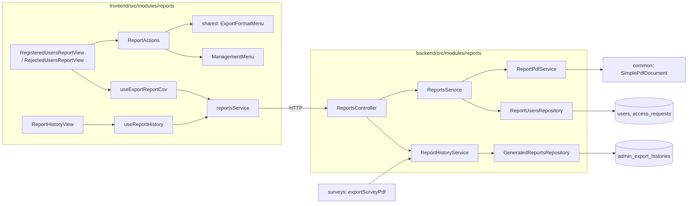
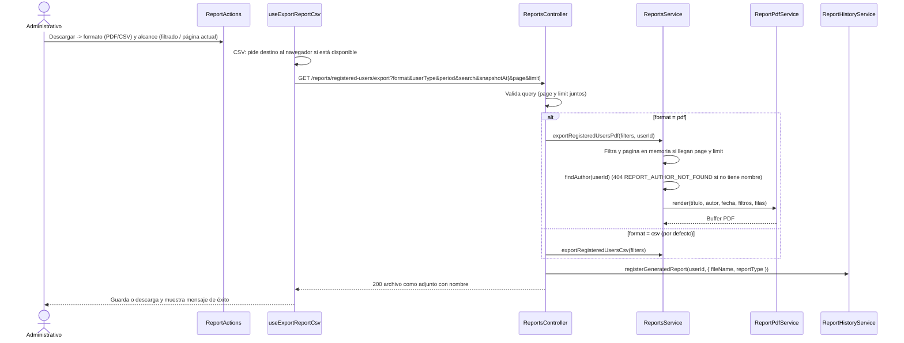

# Reports (reportes administrativos)

## Propósito

El módulo `reports` ofrece al personal administrativo los reportes de usuarios aceptados y rechazados, su exportación en CSV y PDF, y el historial de reportes generados. También expone utilidades de semestre académico y el historial a otros dominios (por ejemplo, el informe PDF de encuestas).

- Backend: `backend/src/modules/reports` (`ReportsController`, `ReportsService`, `ReportPdfService`, `ReportHistoryService`, repositorios de usuarios y de reportes generados).
- Frontend: `frontend/src/modules/reports` (vistas de usuarios aceptados, rechazados e historial, menú de descarga con formato y alcance, menú de gestión).

## Funcionalidad

| Funcionalidad | Backend | Ruta frontend |
| --- | --- | --- |
| Usuarios aceptados paginados y filtrados | `GET /reports/registered-users` | `/backoffice/reports/registered-users` |
| Usuarios rechazados paginados y filtrados | `GET /reports/rejected-users` | `/backoffice/reports/rejected-users` |
| Exportar en CSV o PDF, todo el filtro o solo la página actual | `GET /reports/registered-users/export`, `GET /reports/rejected-users/export` | `ReportActions` |
| Historial de reportes generados | `GET /reports/history` | `/backoffice/reports/history` |

## Arquitectura

## Flujos clave

### Exportar un reporte

## Reglas de negocio

- **Acceso.** Todo el controlador exige JWT y rol `administrativo`.
- **Filtros.** `userType` (rol o `ALL`), `period` (`I-AAAA` / `II-AAAA` o `ALL`), `search` y `snapshotAt` (fecha de corte ISO 8601 con zona). `ALL` equivale a no filtrar.
- **Alcance de exportación.** Sin `page` ni `limit` se exporta todo el resultado filtrado; con ambos se exporta solo esa página. Enviar solo uno de los dos responde 400.
- **Formato.** `format` = `csv` (por defecto) o `pdf`. Ambos usan el mismo nombre base (`buildExportFileName`) con extensión `.csv` o `.pdf`.
- **PDF.** Hoja A4 horizontal con cabecera institucional (UMSS, UMSSY), tarjetas de fecha de generación, autor (`Nombre Apellido (Administrativo)`) y total de registros, píldoras con los filtros aplicados, fecha de generación con `formatBoliviaDateTime` (`DD/MM/AAAA HH:mm`, hora de Bolivia, compartido con el resto del backend), tabla con nombre, correo, tipo de usuario, documento y fecha de aprobación o rechazo, filas alternadas, salto de página con cabecera repetida y pie "Página X de Y". Sin filas muestra "No hay resultados disponibles para exportar.".
- **Filtro de fecha en el PDF.** La gestión se muestra como la fecha de inicio del semestre (`01/01/AAAA` o `01/07/AAAA`); sin gestión, "Todas las fechas".
- **Historial.** Cada exportación (CSV o PDF) registra el archivo y su tipo (`REGISTERED_USERS` o su variante por tipo de usuario, y `REJECTED_USERS`); el informe de encuestas registra `SURVEY_STATISTICS`.
- **Frontend.** Evita exportaciones simultáneas, muestra el mensaje de éxito 4 s y un toast de error si falla. El menú de gestión lista los semestres académicos con la opción "Todas".

## Endpoints

### Expuestos

| Método | Ruta | Query | Respuesta | Errores |
| --- | --- | --- | --- | --- |
| GET | `/reports/registered-users` | `page`, `limit`, `userType`, `period`, `search`, `snapshotAt` | 200 página de usuarios aceptados | 400 |
| GET | `/reports/registered-users/export` | Filtros + `format` (`csv`/`pdf`), `page` y `limit` opcionales y juntos | 200 `text/csv` o `application/pdf` | 400, 404 `REPORT_AUTHOR_NOT_FOUND` (PDF) |
| GET | `/reports/rejected-users` | Igual que aceptados | 200 página de usuarios rechazados | 400 |
| GET | `/reports/rejected-users/export` | Igual que aceptados | 200 `text/csv` o `application/pdf` | 400, 404 (PDF) |
| GET | `/reports/history` | `page`, `limit`, `reportType`, `search`, `snapshotAt` | 200 página de reportes generados | 400 |

Todas requieren JWT y rol `administrativo`. Las respuestas JSON usan `{ statusCode, data, detail, ok }`; las exportaciones son binarias con `Content-Disposition: attachment`.

Swagger (`/docs`) documenta cada endpoint con `operationId`, Bearer JWT, roles, parámetros y restricciones tomados de los esquemas Zod, ejemplos de éxito con el envoltorio `{ statusCode, ok, detail, data }`, los errores que lanza el código y 401, 403 y 500 declarados de forma explícita. Los ejemplos viven en `constants/*-swagger.constants.ts` del módulo y el esquema de error compartido en `backend/src/common/constants/api-error-swagger.constants.ts`. Las exportaciones declaran `text/csv` y `application/pdf` con esquema binario y las cabeceras `Content-Type` y `Content-Disposition`.

### Servicios exportados

| Servicio | Consumidor | Uso |
| --- | --- | --- |
| `ReportHistoryService.registerGeneratedReport` | surveys | Registrar el informe PDF de una encuesta |
| `GeneratedReportsRepository` | surveys | Acceso al historial |
| `getAcademicPeriod` (`utils/academic-period.ts`) | surveys | Semestre académico de una fecha |

## Dependencias

| Dirección | Módulo | Uso |
| --- | --- | --- |
| Usa | common | `SimplePdfDocument`, `formatBoliviaDateTime`, paginación, `ResponseInterceptor` |
| Usado por | [surveys](../surveys/README.md) | Historial de reportes y semestres académicos |
| Usa (frontend) | shared | `ExportFormatMenu` (menú de formato compartido con los mapas de calor), `downloadFile` |

## Datos

Lee `users` y `access_requests` para los reportes de usuarios y escribe en `admin_export_histories` (historial). Ver [backend/prisma/README.md](../../backend/prisma/README.md).

## Sprint History

### Sprint 3

- Exportación en PDF de los reportes de usuarios aceptados y rechazados (`format=pdf`) con cabecera institucional, autor, filtros aplicados y paginación del documento.
- Alcance de descarga: todo el reporte filtrado o solo la página actual (`page` + `limit`).
- Menú de descarga con selección de formato (`ExportFormatMenu` compartido) y alcance en el frontend.
- Registro en el historial de las exportaciones CSV y PDF.
- Contratos Swagger completos de listados, exportaciones e historial.
- Navegación separada entre "Reportes" y "Mapas de calor" en el backoffice.
