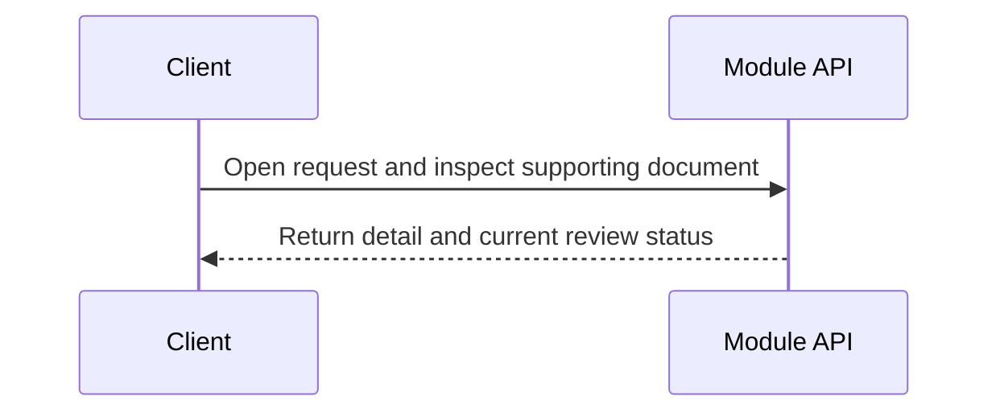

# Access request review

Administrators filter the access inbox, inspect submitted documents and record decisions from request detail.

## Rules and dependencies

The frontend uses the access-requests backend. Status summaries, automation and history are separate reads. Decisions and approval reversal are state changes.

## HTTP contract

- `GET /access-requests`
- `GET /access-requests/summary`
- `GET /access-requests/:id`
- `GET /access-requests/:id/document`
- `GET /access-requests/:id/history`
- `GET /access-requests/automation-summary`
- `PATCH /access-requests/:id/approve`
- `PATCH /access-requests/:id/reject`
- `PATCH /access-requests/:id/revert-approval`

## Main flow

## Sprint History

### Sprint 3

Administrators filter the access inbox, inspect submitted documents and record decisions from request detail.
