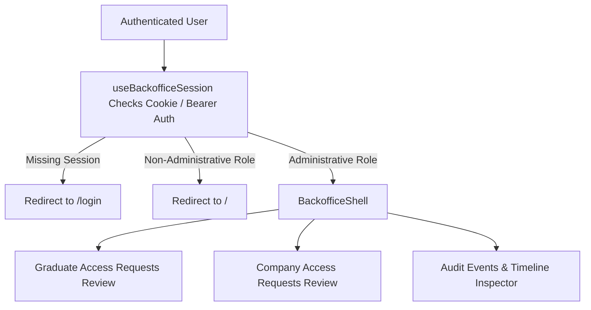

# Request Review Module

## Overview

The **Request Review Module** implements the administrative backoffice interface (`frontend/src/modules/request-review`) for reviewing graduate access requests, automation history, company access requests, and audit events.

## Backoffice Navigation & Access Flow

## Key Responsibilities
- **Session Verification**: `useBackofficeSession` and `useBackofficeUser` work seamlessly with both `HttpOnly` cookie sessions (`AuthProvider`) and Bearer headers, enforcing the `administrativo` role before rendering review views.
- **Review Workspaces**: Dedicated queues for graduate verification (`access-requests`), company verification (`company-access-requests`), OCR inspection, approval/rejection verdicts, and audit traceability (`audit-events`).

## Sprint History

### Sprint 3
- Integrated company access request review workflows and audit event inspection into the backoffice review shell.
- Updated `useBackofficeSession` and `useBackofficeUser` to recognize active `HttpOnly` cookie sessions seamlessly alongside Bearer credentials.
