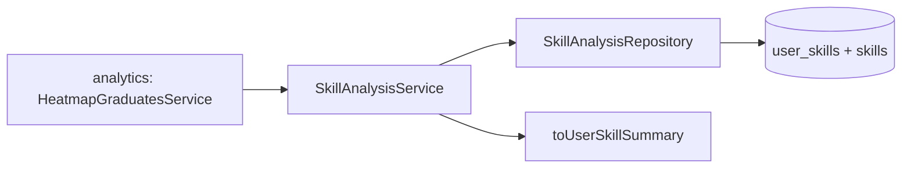
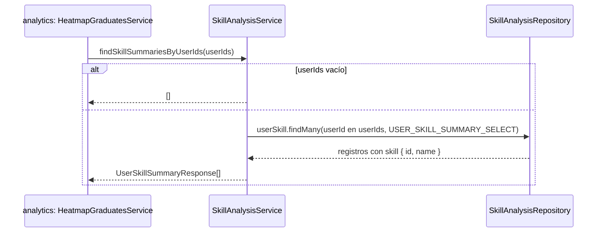

# Skills (habilidades)

## Propósito

El módulo `skills` mantiene el catálogo de habilidades y las habilidades de cada perfil, tanto las añadidas manualmente (`source = manual`) como las detectadas por el pipeline NLP (`source = nlp`). `SkillAnalysisModule` agrupa los servicios de análisis y lectura de habilidades que consumen otros dominios.

Este documento describe la consulta de resumen de habilidades añadida en el Sprint 3.

## Servicios de lectura para otros dominios

`SkillAnalysisService` (exportado por `SkillAnalysisModule`):

| Método | Devuelve | Consumidor |
| --- | --- | --- |
| `findSkillSummariesByUserIds(userIds)` | `UserSkillSummaryResponse[]` (`userId`, `skillId`, `skillName`, `source`) de todas las habilidades de esos usuarios. Con lista vacía no consulta la base | [analytics](../analytics/README.md) (filas de los mapas de calor; el mapa salarial usa solo `source = nlp`) |

## Reglas de negocio

- Devuelve todas las habilidades del usuario, sin filtrar por origen; el consumidor decide (por ejemplo, analytics deduplica por `skillId` y marca las de origen `nlp`).
- Solo lectura; no tiene endpoint HTTP propio.

## Dependencias

| Dirección | Módulo | Uso |
| --- | --- | --- |
| Usado por | [analytics](../analytics/README.md) | Habilidades por titulado para los mapas de calor |

## Datos

Tablas `skills` y `user_skills` (ver [backend/prisma/README.md](../../backend/prisma/README.md)).

## Sprint History

### Sprint 3

- `SkillAnalysisService.findSkillSummariesByUserIds` y el contrato `UserSkillSummaryResponse` para alimentar los mapas de calor.
