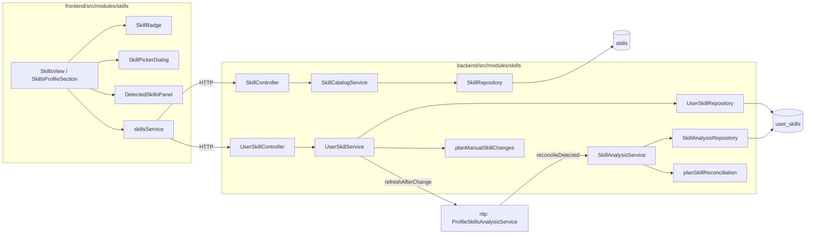
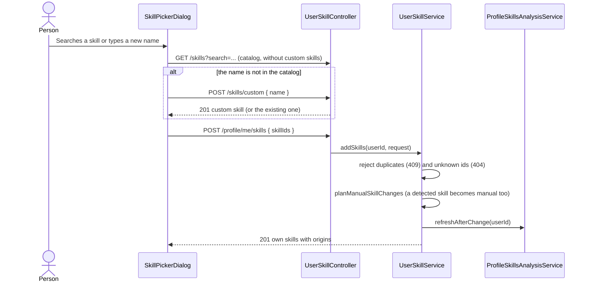
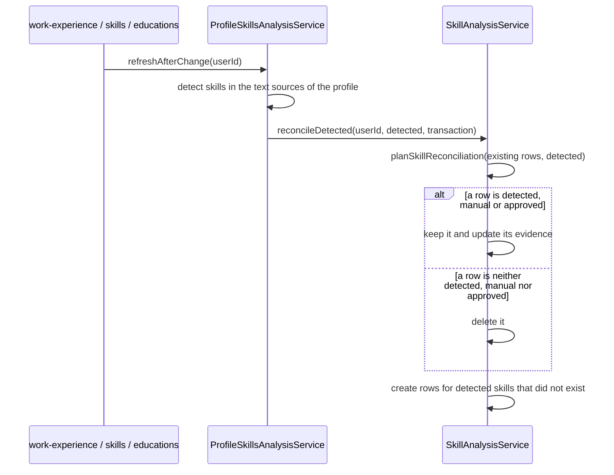
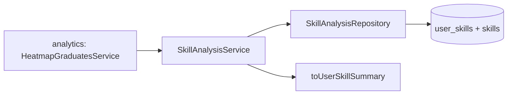
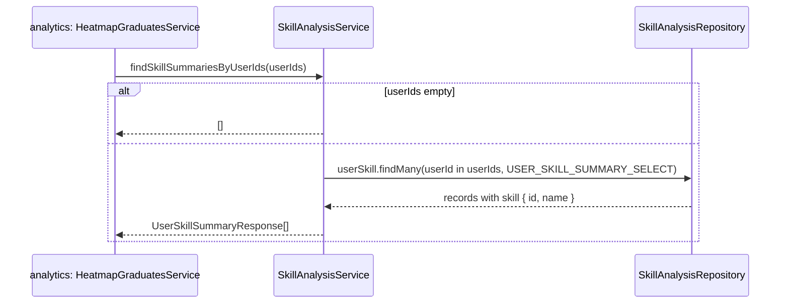

# Skills

## Purpose

Holds the catalog of skills and the skills of each person's profile. A person can add skills by hand, and the platform adds the ones it detects in their work experience (and other profile sources). The same catalog is what companies pick from when they publish a vacancy, which is what makes the affinity calculation of [matching](../matching/README.md) possible.

Owner: group 5. The detection pipeline (`nlp`) and the radar chart that consumes the skills belong to other teams.

## Functionality

| Feature                                                                               | Where                               |
| ------------------------------------------------------------------------------------- | ----------------------------------- |
| Search the skill catalog                                                              | `GET /skills?search=`               |
| Create a custom skill (or reuse the existing one with that name)                      | `POST /skills/custom`               |
| See my skills with their origin: manual, experience or CV                             | `GET /profile/me/skills`            |
| Add skills, or replace the whole list                                                 | `POST` and `PUT /profile/me/skills` |
| Remove only the skills that were added by hand and have no other evidence             | `SkillBadge`                        |
| Clean up detected skills when their experience is deleted                             | `planSkillReconciliation`           |
| "Habilidades detectadas" panel with the state of the analysis and a re-analyze button | `DetectedSkillsPanel`               |

## Architecture

## Key flows

### Add skills by hand

### Detected skills follow the sources

## Business rules

- **Catalog.** `GET /skills` returns only non-custom skills ordered by name; `search` is a case-insensitive "contains" of up to 100 characters. Detection and vacancy publishing use this catalog.
- **Custom skills.** The name is normalized (formatted, up to 50 characters, only letters, digits and ` + # . - _ / & ( )`, at least one letter, no character repeated more than 3 times in a row). Creating a name that already exists returns the existing skill instead of an error.
- **Own skills.** At most 50 ids per request. Duplicated ids in the same request answer 409 `DuplicateSkillException`; an unknown id answers 404 `SkillNotFoundException`. `PUT` replaces the whole list, `POST` adds to it. Both ask the detection pipeline to refresh afterwards.
- **Origin of a skill** is derived, not stored: `manual` when its source is manual, `experience` when its evidence points to a work experience, `cv` when it points to the CV. A skill can have several origins.
- **Removing a skill.** In the client the "X" appears only when the skill is manual and has no experience or CV evidence. A skill that is also supported by an experience cannot be removed even if the person added it by hand; if its only experience is deleted, the "X" comes back.
- **Reconciliation of detected skills.** Rows that are neither detected, nor manual, nor approved are deleted; the rest keep their evidence updated; new detections create rows. When a person turns a detected skill into a manual one, or removes a manual skill that still has evidence, it is converted instead of deleted (`planManualSkillChanges`).
- A skill is "high relevance" when it has evidence references.
- Detected skills that are still pending review do not increase the verified radar.
- Chips of vacancy skills and experience skills use the light blue availability tokens.

## Endpoints

All endpoints require a valid JWT (any role).

| Method | Path                 | Description                                                          | Success                                          | Errors                                                      |
| ------ | -------------------- | -------------------------------------------------------------------- | ------------------------------------------------ | ----------------------------------------------------------- |
| GET    | `/skills`            | Catalog. Query: `search` (max 100)                                   | 200 `SkillResponse[]`                            | 400                                                         |
| POST   | `/skills/custom`     | Creates a custom skill or returns the existing one. Body: `{ name }` | 201 `SkillResponse`                              | 400 invalid name                                            |
| GET    | `/profile/me/skills` | Own skills with `origins`                                            | 200 `OwnSkillResponse[]`                         | 404 profile not found                                       |
| PUT    | `/profile/me/skills` | Replaces the own skills. Body: `{ skillIds }` (max 50)               | 200 `OwnSkillResponse[]`                         | 404 `SkillNotFoundException`, 409 `DuplicateSkillException` |
| POST   | `/profile/me/skills` | Adds skills. Same body                                               | 201 `OwnSkillResponse[]` (Swagger documents 200) | 404, 409                                                    |

The "Habilidades detectadas" panel uses `GET` and `POST /profile/me/skills/analysis`, which belong to the `nlp` module.

## Dependencies

| Direction | Module                                          | Use                                                                             |
| --------- | ----------------------------------------------- | ------------------------------------------------------------------------------- |
| Uses      | nlp                                             | `ProfileSkillsAnalysisService.refreshAfterChange` after changing the own skills |
| Uses      | profile                                         | `ProfileService.ensureProfileExists` before reading or writing skills           |
| Used by   | [matching](../matching/README.md)               | User skills (`UserSkillService`) and the catalog (`SkillCatalogService`)        |
| Used by   | [job-offers](../job-offers/README.md)           | Validates the skills selected for a vacancy                                     |
| Used by   | [work-experience](../work-experience/README.md) | Detected skills are reconciled after each experience change                     |
| Used by   | nlp, radar-integration                          | `reconcileDetected`, `findProfileSkillRows`, review and publication helpers     |

## Data

Tables `skills` and `user_skills` (see [backend/prisma/README.md](../../backend/prisma/README.md)). `skills.area_id` links each skill to a radar area.

## Frontend

- Components: `SkillsProfileSection` and `SkillsGuideStep` (profile and completion guide), `SkillPickerDialog`, `SkillBadge`, `DetectedSkillsPanel`.
- The panel polls every 1.5 seconds while the analysis is pending and refreshes the profile completeness when a new result is ready.
- Query keys `["skills", "profile"]`, `["skills", "detected"]` and the analysis mutation key are the ones other modules invalidate after a change.

## Design decisions

- **Evidence-based skills.** Instead of storing "this skill came from that job", each skill carries `evidence_refs`; origins and cleanup are derived from them, so deleting an experience removes exactly what only it supported.
- **Manual wins over detected.** A skill the person typed is never silently deleted by the pipeline.
- **Custom skills do not pollute detection.** They are flagged `is_custom` and left out of the public catalog and of the detection dictionary, but a person can still keep them in their profile.
- **The catalog is the single source of names.** Vacancies, detection and profile all point to `skills`, so affinity compares ids and names that really match.
- **Planning is separated from writing.** `planSkillReconciliation` and `planManualSkillChanges` are pure functions that decide what to create, update or delete; the repository only applies the plan inside a transaction.

## Read services for other domains

The `skills` module keeps the skill catalog and the skills of each profile, both the ones added by hand (`source = manual`) and the ones detected by the NLP pipeline (`source = nlp`). `SkillAnalysisModule` groups the skill analysis and read services that other domains consume.

`SkillAnalysisService` (exported by `SkillAnalysisModule`):

| Method | Returns | Consumer |
| --- | --- | --- |
| `findSkillSummariesByUserIds(userIds)` | `UserSkillSummaryResponse[]` (`userId`, `skillId`, `skillName`, `source`) with all the skills of those users. With an empty list it does not query the database | [analytics](../analytics/README.md) (heatmap rows; the salary map uses only `source = nlp`) |

### Read rules

- Returns all the skills of the user, without filtering by origin; the consumer decides (for example, analytics deduplicates by `skillId` and flags the ones with origin `nlp`).
- Read only; it has no HTTP endpoint of its own.

### Read dependencies

| Direction | Module | Use |
| --- | --- | --- |
| Used by | [analytics](../analytics/README.md) | Skills per graduate for the heatmaps |

### Read frontend integration

The frontend does not call this service; its data is shown in the backoffice heatmaps (`frontend/src/modules/heatmaps`, `/backoffice/reports/heatmaps/*`).

## Sprint History

### Sprint 3

- Skill catalog search and custom skills.
- Own skills with manual, experience and CV origins; the "X" only on removable chips.
- Cleanup of detected skills when a work experience is deleted.
- Detected skills panel with analysis state and manual re-analysis.
- Skill chips in light blue for experiences and vacancies.
- `SkillAnalysisService.findSkillSummariesByUserIds` and the `UserSkillSummaryResponse` contract to feed the heatmaps.
