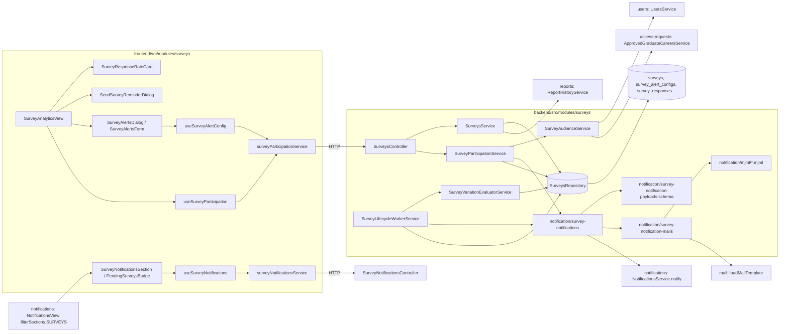
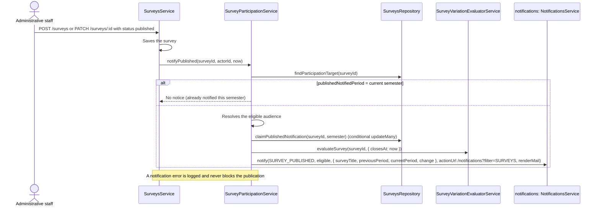
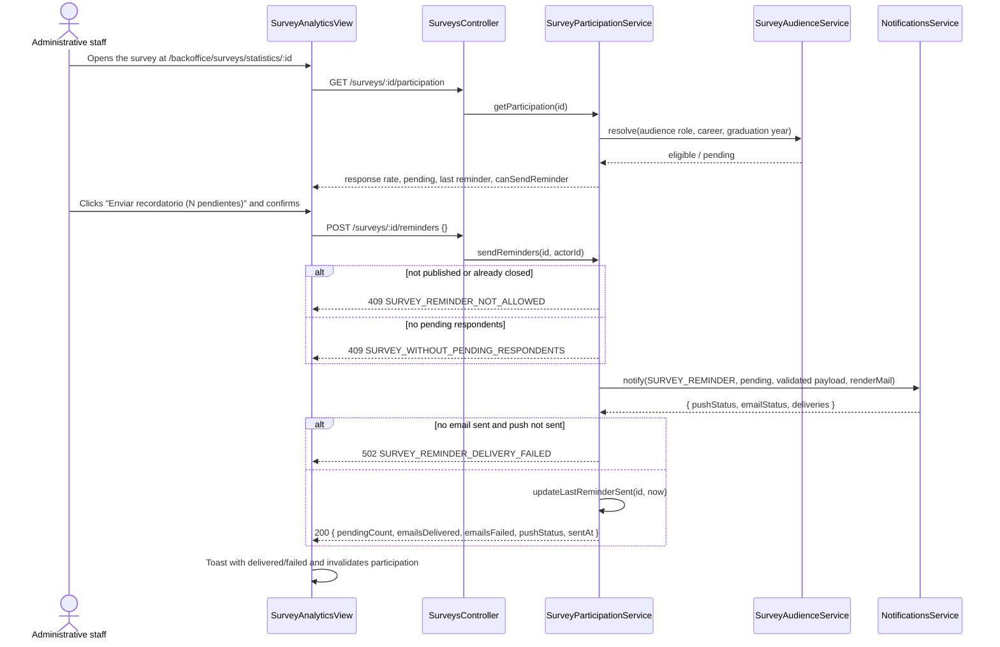
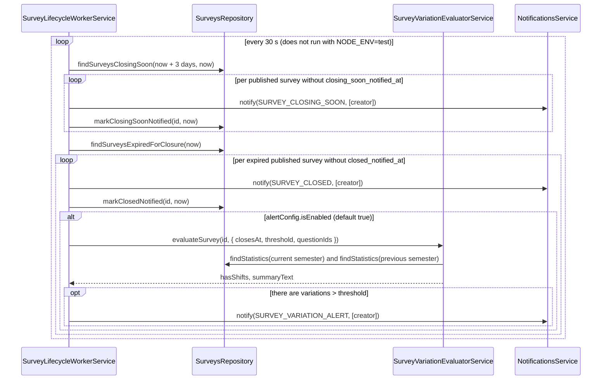
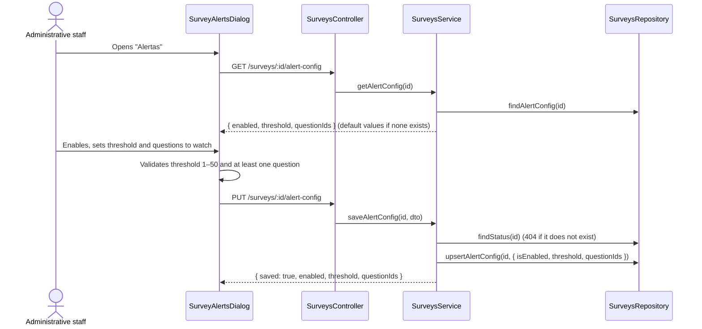

# Surveys (employability surveys)

## Purpose

The `surveys` module lets administrative staff create, publish and analyze employability surveys aimed at graduates, students or mentors of a career and academic year, and lets those audiences answer them. Since Sprint 3 it also tracks audience participation, manual reminders, variation alerts between semesters and automatic closing notices to the survey creator.

- Backend: `backend/src/modules/surveys` (controllers `SurveysController`, `SurveyNotificationsController`, `CareersController`; services for surveys, participation, audience, variation, lifecycle, PDF and employability responses; `notification/` folder with the survey notification contracts).
- Frontend: `frontend/src/modules/surveys` (survey builder, answer view, backoffice list, analytics view with the response rate card, reminder dialog and alerts dialog, and the survey notices section and pending badge shown inside the central notifications inbox).

## Functionality

| Feature | Where |
| --- | --- |
| Create, edit draft, publish and disable surveys | `POST /surveys`, `PATCH /surveys/:id`, `PATCH /surveys/:id/unpublish`; `/backoffice/surveys`, `/backoffice/surveys/create`, `/backoffice/surveys/:id` |
| Answer a survey | `GET /surveys/:id`, `POST /surveys/:id/responses`; `/surveys/:id` (`/surveys` redirects to `/notifications?filter=SURVEYS`) |
| Notices of surveys assigned to the user | `GET /surveys/notifications`; `SurveyNotificationsSection` inside the "Notificaciones de Encuestas" filter of the central inbox, `PendingSurveysBadge` on that sidebar entry |
| Statistics per semester and PDF report | `GET /surveys/:id/statistics`, `GET /surveys/:id/report`; `/backoffice/surveys/statistics/:id` |
| Response rate of the target audience | `GET /surveys/:id/participation`; `SurveyResponseRateCard` |
| Manual reminder to those who have not answered | `POST /surveys/:id/reminders`; `SendSurveyReminderDialog` |
| Variation alert configuration | `GET` / `PUT /surveys/:id/alert-config`; `SurveyAlertsDialog` |
| Automatic closing-soon, closing and variation notices | `SurveyLifecycleWorkerService` |
| Employability responses for other domains | `SurveyEmploymentResponsesService` (exported) |
| Available careers | `GET /careers`; `CareersService` (exported) |

## Architecture

### Survey notifications

Survey notifications belong to the `surveys` domain and live in `backend/src/modules/surveys/notification/`:

| File | Responsibility |
| --- | --- |
| `survey-notifications.ts` | Builds the request for `NotificationsService.notify()` (`type`, validated `payload` and `renderMail`) for `SURVEY_PUBLISHED`, `SURVEY_REMINDER`, `SURVEY_CLOSING_SOON`, `SURVEY_CLOSED` and `SURVEY_VARIATION_ALERT` |
| `survey-notification-payloads.schema.ts` | Zod schemas for each payload (title 1–150 characters, non-empty formatted date, integer responses ≥ 0, threshold 1–50, non-empty summary). An invalid payload throws before `notify()` is called |
| `survey-notification-mails.ts` | Subject, plain text and values of each email; reads its template with `loadMailTemplate` from `mail` and converts the relative `actionUrl` into an absolute URL (`toAbsoluteSurveyUrl`) for the email button |
| `mjml/survey-published.mjml`, `mjml/survey-reminder.mjml`, `mjml/survey-closing-soon.mjml`, `mjml/survey-closed.mjml`, `mjml/survey-variation-alert.mjml` | MJML content of each email; `mail` wraps it with `layout.mjml` and `header.mjml`. The build copies them to `dist/modules/surveys/notification/mjml/` (`scripts/copy-mail-templates.ts` and `assets` in `nest-cli.json`) |

The `notifications` module is core infrastructure: it stores the in-app notification, emits it over WebSocket and dispatches push and email according to the `notification_types` catalog and the recipient's preferences. It returns the status per channel and the detail per recipient (`deliveries`), which `surveys` uses to count delivered and failed emails.

## Key flows

### Publication notice

### Manual reminder

### Automatic lifecycle (closing soon, closing and variation)

### Configure variation alerts

## Business rules

### General

- Survey management (create, edit, disable, list, statistics, PDF, participation, reminders and alerts) is exclusive to the `administrativo` role. Viewing and answering a survey (`GET /surveys/:id`, `POST /surveys/:id/responses`) and viewing notices (`GET /surveys/notifications`) is also allowed for `titulado`, `estudiante` and `mentor`.
- A person answers a survey only once (`survey_responses` unique by `survey_id` + `respondent_id`).
- Exporting the PDF report registers the file in the report history (`reportType = SURVEY_STATISTICS`).

### Participation and reminders

- **Eligible audience.** Active users with the role of the target audience (`all` = titulado, estudiante and mentor; `graduates` = titulado; `students` = estudiante; `mentors` = mentor). If the survey has a career or an academic year (`academicPeriod` = `AAAA`), only users with an approved access request for that career and with that graduation year are included. `Todas` does not filter by year.
- **Pending** = eligible users who have not answered yet. `responseRate` = answered / eligible, rounded and capped at 100; 0 if there are no eligible users.
- **Reminders** only for published surveys whose closing date has not passed (or that have no closing date), and only to pending users. Those who already answered receive nothing.
- It is sent as `SURVEY_REMINDER` (push and email according to the catalog and the preferences). If no email was delivered and push was neither `sent` nor `partial`, it responds 502 and does not update `last_reminder_sent_at`.
- Reminders are **only sent manually** from the backoffice; the worker does not send reminders.
- Frontend: progress meter with the uniform institutional color and a participation level label of low (≤ 35 %), medium (≤ 65 %) or expected (> 65 %). The button is disabled if there are no pending users or `canSendReminder` is false.

### Variation alerts (`SurveyAlertConfig`)

- Optional 1:1 configuration with the survey. Without a record, the default values `enabled = true`, `threshold = 10`, `questionIds = null` (all questions) are used.
- `threshold`: integer from 1 to 50 percentage points. `questionIds`: list of ids of the questions to watch; `null` or empty watches all of them. The body accepts `enabled` or `isEnabled` (`enabled` takes precedence).
- When the survey closes, the percentage of responses of the current semester is compared with that of the previous semester, per question and option. The current semester is derived only from `closesAt` (or from the current date if the survey has no closing date); `academicPeriod` is the cohort year (`AAAA` or `Todas`), not a semester, and plays no part in the comparison. For example, a survey that closes on 15/11/2024 compares II-2024 with I-2024. Every option with `|diferencia| > threshold` is reported (a variation equal to the threshold does not trigger an alert). If either of the two semesters has no responses, there is no alert.
- Frontend: with alerts enabled it requires at least one selected question; on save it sends the ids of the checked questions.

### Publication notice (`SURVEY_PUBLISHED`)

- It is sent when a survey is created as published or a draft is published, to the eligible audience of the survey (same criterion as the response rate).
- Payload validated with Zod: `surveyTitle`, `previousPeriod`, `currentPeriod` (semester of the publication) and `change`, a text summary of the variations between the previous and current semester (or "Sin variaciones registradas respecto al semestre anterior.").
- Link `/notifications?filter=SURVEYS` (the "Notificaciones de Encuestas" filter of the central notifications inbox), without `groupKey`. That filter shows the `SurveyNotificationsSection` (pending, expired and answered surveys with the "Responder encuesta" link to `/surveys/:id`) above the notification history, so there is a single inbox. The section and the pending badge only render for the roles that can answer surveys (`titulado`, `estudiante`, `mentor`).
- A single notice per survey and semester: `published_notified_period` is claimed with a conditional `updateMany` before sending, so republishing in the same semester or concurrent publications do not duplicate it.

### Automatic lifecycle

- The worker checks every 30 s. One run never overlaps another.
- **Closing soon**: published surveys that close within the next 72 h and have no `closing_soon_notified_at`. The creator is notified (`SURVEY_CLOSING_SOON`, email only) and the date is marked.
- **Closing**: published surveys with `closes_at <= now` and no `closed_notified_at`. The creator is notified (`SURVEY_CLOSED`, email only), the date is marked and, if alerts are enabled, the variation is evaluated (`SURVEY_VARIATION_ALERT`, email only).
- If the survey has no closing date, the notices use the text `SURVEY_WITHOUT_CLOSING_DATE_TEXT` ("Sin fecha de cierre definida.") instead of an empty date.
- The `closing_soon_notified_at` and `closed_notified_at` marks guarantee a single notice per survey. An error in one survey is logged and does not stop the others.
- Notice links are relative routes so the notifications inbox opens them inside the app: `/backoffice/surveys/statistics/:id` for the creator, `/notifications?filter=SURVEYS` for the publication notice and `/surveys/:id` for reminders. The emails turn them into absolute URLs with `FRONTEND_URL` (or the first `CORS_ORIGIN`).

## Endpoints

### Exposed

| Method | Route | Roles | Description | Response | Errors |
| --- | --- | --- | --- | --- | --- |
| POST | `/surveys` | administrativo | Creates a draft or published survey | 201 | 400, 404 career, 409 duplicate title |
| GET | `/surveys` | administrativo | Lists surveys | 200 | |
| GET | `/surveys/:id` | administrativo, titulado, estudiante, mentor | Detail for answering or editing | 200 | 403 not aimed at the profile, 404 |
| PATCH | `/surveys/:id` | administrativo | Updates draft / publishes | 200 | 400, 404, 409 |
| PATCH | `/surveys/:id/unpublish` | administrativo | Returns to draft if it has no responses | 204 | 404, 409 |
| POST | `/surveys/:id/responses` | administrativo, titulado, estudiante, mentor | Records responses | 201 | 400 not open or expired, 403, 404, 409 already answered |
| GET | `/surveys/:id/statistics?period=` | administrativo | Statistics per semester | 200 | 400, 404 |
| GET | `/surveys/:id/report?period=` | administrativo | PDF report | 200 `application/pdf` | 404 |
| GET | `/surveys/:id/alert-config` | administrativo | Alert configuration (or default values) | 200 `{ enabled, threshold, questionIds }` | 400 |
| PUT | `/surveys/:id/alert-config` | administrativo | Creates or updates the configuration | 200 `{ saved, enabled, threshold, questionIds }` | 400, 404 |
| GET | `/surveys/:id/participation` | administrativo | Audience coverage | 200 `SurveyParticipationResponse` | 404 |
| POST | `/surveys/:id/reminders` | administrativo | Reminder to pending users. Body `{}` | 200 `SurveyReminderResponse` | 404, 409, 502 |
| GET | `/surveys/notifications` | administrativo, titulado, estudiante, mentor | Survey notices for the user | 200 | |
| GET | `/careers` | administrativo | Careers sorted by title | 200 | |

All of them require JWT. JSON responses use the `{ statusCode, data, detail, ok }` contract.

Swagger (`/docs`) documents each endpoint with `operationId`, Bearer JWT, roles, parameters and constraints taken from the Zod schemas, success examples with the `{ statusCode, ok, detail, data }` envelope, the errors the code throws, and 401, 403 and 500 declared explicitly. The examples live in the module's `constants/*-swagger.constants.ts` and the shared error schema in `backend/src/common/constants/api-error-swagger.constants.ts`.

### Exported services

| Service | Consumer | Use |
| --- | --- | --- |
| `CareersService.listCareers(sortOrder)` | analytics | Columns of the map per career (`desc`) |
| `SurveyEmploymentResponsesService.findEmploymentResponses({ careerId, from, to })` | analytics | Responses with employment status and salary range of active, approved graduates |

### Consumed

| Module | Service | Use |
| --- | --- | --- |
| notifications | `NotificationsService.notify()` | Publication notice, reminders and lifecycle notices |
| notifications (frontend) | `NotificationsView` (`filterSections`) | Shows `SurveyNotificationsSection` in the "Notificaciones de Encuestas" filter of the central inbox |
| users | `UsersService.findActiveContactsByRoles` | Active users by audience role |
| access-requests | `ApprovedGraduateCareersService.findApprovedUserIds` | Cohort by career and graduation year |
| reports | `ReportHistoryService.registerGeneratedReport`, `getAcademicPeriod` | PDF history and semester calculation |
| mail | `loadMailTemplate` | Reading the templates in `surveys/notification/mjml/` |
| mail (via notifications) | `MailService` | Sending the MJML from `surveys/notification/mjml/` |

## Dependencies

| Direction | Module | Use |
| --- | --- | --- |
| Uses | [notifications](../notifications/README.md) | In-app, push and email delivery |
| Uses (frontend) | [notifications](../notifications/README.md) | Central inbox (`/notifications?filter=SURVEYS`) that hosts the survey notices section |
| Uses | [mail](../mail/README.md) | `loadMailTemplate` to read the domain's `.mjml` templates |
| Uses | [users](../users/README.md) | Active contacts by role |
| Uses | [access-requests](../access-requests/README.md) | Approved graduates by career and academic year |
| Uses | [reports](../reports/README.md) | Report history and academic semesters |
| Used by | [analytics](../analytics/README.md) | Employability responses and careers |
| Used by (frontend) | heatmaps | `useCareers` for the career filter |

## Data

Tables `surveys`, `survey_alert_configs`, `survey_questions`, `survey_question_options`, `survey_responses`, `survey_answers` and the catalogs `survey_statuses`, `survey_question_types`, `survey_target_audiences` (see [backend/prisma/README.md](../../backend/prisma/README.md)). In Sprint 3 `surveys` adds `closing_soon_notified_at`, `closed_notified_at`, `last_reminder_sent_at` and `published_notified_period` (`VARCHAR(7)`, nullable), and `survey_alert_configs` is created (1:0..1 with `surveys`, cascade delete).

## Frontend

- `SurveyAnalyticsView` (`/backoffice/surveys/statistics/:id`) shows `SurveyResponseRateCard`, the reminder button with its confirmation dialog and the "Alertas" button.
- Query keys `SURVEYS_QUERY_KEYS.participation(id)` and `SURVEYS_QUERY_KEYS.alertConfig(id)`; sending a reminder or saving alerts invalidates its key.
- `toSurveyAlertQuestions` names the questions `P1`, `P2`... by position; `formatReminderResult` builds the delivered and failed message.
- Single inbox: the survey module no longer has its own inbox page. It delegates to the central notifications inbox of [notifications](../notifications/README.md): `/notifications` renders `SurveyNotificationsSection` (data from `GET /surveys/notifications`) through the `filterSections.SURVEYS` slot of `NotificationsView`, and `PendingSurveysBadge` is shown on the "Notificaciones de Encuestas" sidebar sub-item (`SURVEY_NOTIFICATIONS_LABEL`). `/surveys` redirects to `/notifications?filter=SURVEYS` (`SURVEY_NOTIFICATIONS_PATH`), which is also where the answer view goes back to; answering stays at `/surveys/:id` (`SURVEY_ANSWER_PATH`).
- The section reuses the shared inbox components of [notifications](../notifications/README.md): each row is a `NotificationCard` (red dot when pending, survey icon with its status tone, title, message, date) whose action is a small "Responder encuesta" link to `/surveys/:id`, or a disabled "Encuesta caducada" / "Encuesta registrada" button. Loading uses `NotificationsInboxLoading` and the empty state `NotificationsInboxEmpty` with its own icon and texts. The group header ("ENCUESTAS" with the "N pendientes" pill) follows the "AYER" / "ANTERIORES" headers, so the rows keep their structure at any width.
- `SURVEY_NOTIFICATIONS_PATH` and `SURVEY_NOTIFICATIONS_LABEL` are taken from the public contract of notifications (`getNotificationInboxPath("SURVEYS")` and `NOTIFICATION_INBOX_FILTER_LABELS.SURVEYS`), the same values the sidebar uses, so the pending badge stays attached to the "Notificaciones de Encuestas" entry.
- `useCanAnswerSurveys` limits the section and the badge to the roles allowed on `/surveys` (`titulado`, `estudiante`, `mentor`); administrative staff and companies only see the notifications of the central inbox.

## Action styling

Unpublishing a survey updates its publication state through PATCH. The confirmation uses a neutral action, and the Cancel button can dismiss it before submission.

## Sprint History

### Sprint 3

- Response rate of the target audience (`GET /surveys/:id/participation`) and participation card with a uniform meter and a low, medium or expected level label.
- Manual email and push reminder only to those who have not answered (`POST /surveys/:id/reminders`), recording `last_reminder_sent_at` and the result per channel.
- Per-survey variation alert configuration (`SurveyAlertConfig`, `GET`/`PUT /surveys/:id/alert-config`) and evaluator of variation between semesters.
- Lifecycle worker that notifies the creator of the upcoming closing (72 h), the closing and significant variations.
- Domain-owned survey notifications in `surveys/notification/`: payloads validated with Zod, email rendering and templates as `.mjml` files in `surveys/notification/mjml/`, read with `loadMailTemplate` and copied to `dist` during the build.
- The semester of the variation alert is derived from the closing date, not from the cohort year.
- Complete Swagger contracts for all `SurveysController` endpoints.
- `SurveyEmploymentResponsesService` and configurable sort order in `CareersService` to feed the heatmaps.
- Publication notice `SURVEY_PUBLISHED` to the eligible audience through `NotificationsService.notify()`, with its own email template and a single notice per survey and semester (migration `20261119120000_add_survey_published_notified_period`).
- Single criterion for an approved graduate (`findApprovedGraduateUserIds`: `approvedUserId` or, if missing, email), used both to answer and to compute the audience, so the response rate matches the recorded responses.
- Variation alerts: unsaved changes warning, strict threshold (`>`), specific threshold messages and "Guardar" disabled without changes.
- Survey notification links as relative routes (the inbox opens the analytics directly) and absolute URLs in the emails.
- Survey notices unified into the central notifications inbox: `SURVEY_PUBLISHED` links to `/notifications?filter=SURVEYS`, where the survey list and the pending badge are shown; the separate "Notificaciones de encuestas" page and sidebar entry were removed.
- Survey rows in the inbox aligned with the notification card style; the text no longer breaks letter by letter in narrow layouts.
- Survey rows, loading and empty states reuse the shared inbox components of notifications, and the inbox route and label of the surveys filter come from its public contract.
- Formal fixtures (`formal-surveys-and-students.seed.ts`): 10 graduates and 8 surveys with responses and closing scenarios, deterministic and idempotent.
