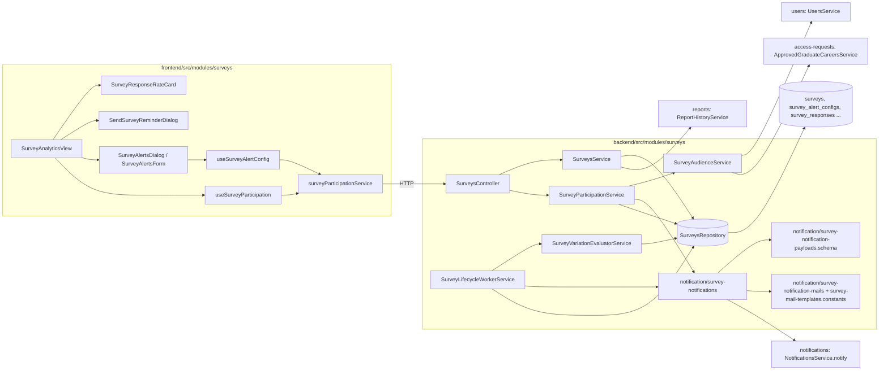
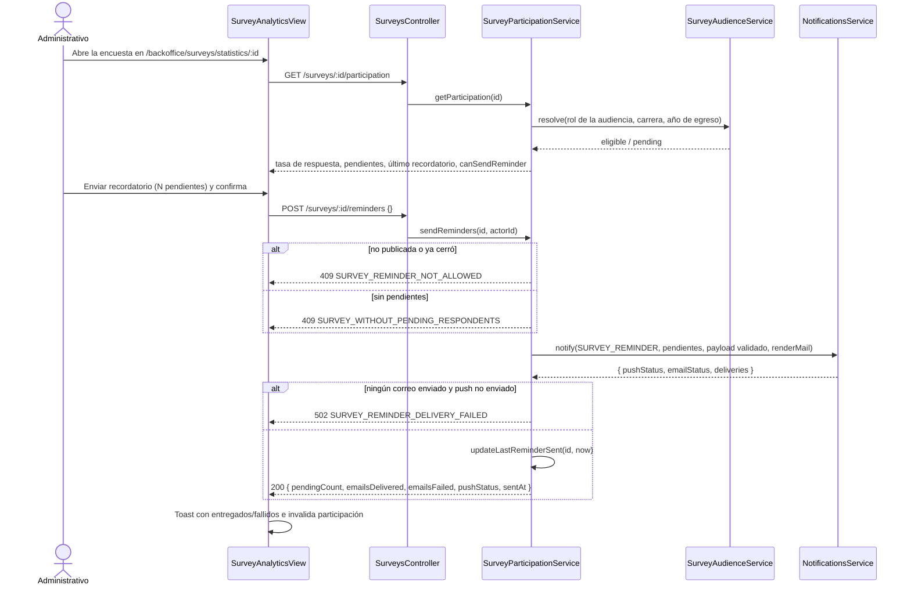
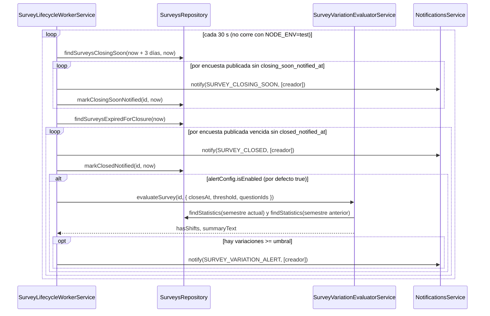
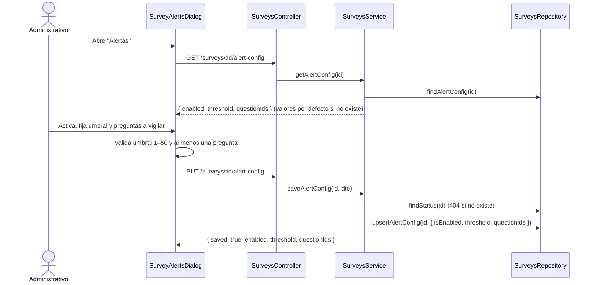

# Surveys (encuestas de empleabilidad)

## Propósito

El módulo `surveys` permite al personal administrativo crear, publicar y analizar encuestas de empleabilidad dirigidas a titulados, estudiantes o mentores de una carrera y gestión, y permite a esas audiencias responderlas. Desde el Sprint 3 también controla la participación de la audiencia, los recordatorios manuales, las alertas de variación entre semestres y los avisos automáticos de cierre al creador de la encuesta.

- Backend: `backend/src/modules/surveys` (controladores `SurveysController`, `SurveyNotificationsController`, `CareersController`; servicios de encuestas, participación, audiencia, variación, ciclo de vida, PDF y respuestas de empleabilidad; carpeta `notification/` con los contratos de las notificaciones de encuestas).
- Frontend: `frontend/src/modules/surveys` (constructor de encuestas, vista de respuesta, listado del backoffice, vista de analíticas con tarjeta de tasa de respuesta, diálogo de recordatorio y diálogo de alertas).

## Funcionalidad

| Funcionalidad | Dónde |
| --- | --- |
| Crear, editar borrador, publicar e inhabilitar encuestas | `POST /surveys`, `PATCH /surveys/:id`, `PATCH /surveys/:id/unpublish`; `/backoffice/surveys`, `/backoffice/surveys/create`, `/backoffice/surveys/:id` |
| Responder una encuesta | `GET /surveys/:id`, `POST /surveys/:id/responses`; `/surveys`, `/surveys/:id` |
| Avisos de encuestas asignadas al usuario | `GET /surveys/notifications` |
| Estadísticas por semestre e informe PDF | `GET /surveys/:id/statistics`, `GET /surveys/:id/report`; `/backoffice/surveys/statistics/:id` |
| Tasa de respuesta de la audiencia objetivo | `GET /surveys/:id/participation`; `SurveyResponseRateCard` |
| Recordatorio manual a quienes no respondieron | `POST /surveys/:id/reminders`; `SendSurveyReminderDialog` |
| Configuración de alertas de variación | `GET` / `PUT /surveys/:id/alert-config`; `SurveyAlertsDialog` |
| Avisos automáticos de cierre próximo, cierre y variación | `SurveyLifecycleWorkerService` |
| Respuestas de empleabilidad para otros dominios | `SurveyEmploymentResponsesService` (exportado) |
| Carreras disponibles | `GET /careers`; `CareersService` (exportado) |

## Arquitectura

### Notificaciones de encuestas

Las notificaciones de encuestas pertenecen al dominio `surveys` y viven en `backend/src/modules/surveys/notification/`:

| Archivo | Responsabilidad |
| --- | --- |
| `survey-notifications.ts` | Construye la petición para `NotificationsService.notify()` (`type`, `payload` validado y `renderMail`) de `SURVEY_REMINDER`, `SURVEY_CLOSING_SOON`, `SURVEY_CLOSED` y `SURVEY_VARIATION_ALERT` |
| `survey-notification-payloads.schema.ts` | Esquemas Zod de cada payload (título 1–150 caracteres, fecha formateada no vacía, respuestas enteras ≥ 0, umbral 1–50, resumen no vacío). Un payload inválido lanza antes de llamar a `notify()` |
| `survey-notification-mails.ts` | Asunto, texto plano y valores de cada correo; toma el MJML de `survey-mail-templates.constants.ts` |
| `survey-mail-templates.constants.ts` (MJML de recordatorio, cierre próximo, cierre y alerta de variación) | Contenido de cada correo como constantes TypeScript, compiladas a `dist` junto al resto del código; `mail` lo envuelve con `layout.mjml` y `header.mjml` |

El módulo `notifications` es infraestructura central: guarda la notificación in-app, emite por WebSocket y despacha push y correo según el catálogo `notification_types` y las preferencias del destinatario. Devuelve el estado por canal y el detalle por destinatario (`deliveries`), que `surveys` usa para contar correos entregados y fallidos.

## Flujos clave

### Recordatorio manual

### Ciclo de vida automático (cierre próximo, cierre y variación)

### Configurar alertas de variación

## Reglas de negocio

### Generales

- La gestión de encuestas (crear, editar, inhabilitar, listar, estadísticas, PDF, participación, recordatorios y alertas) es exclusiva del rol `administrativo`. Ver y responder una encuesta (`GET /surveys/:id`, `POST /surveys/:id/responses`) y ver avisos (`GET /surveys/notifications`) también se permite a `titulado`, `estudiante` y `mentor`.
- Una persona responde una encuesta una sola vez (`survey_responses` único por `survey_id` + `respondent_id`).
- Exportar el informe PDF registra el archivo en el historial de reportes (`reportType = SURVEY_STATISTICS`).

### Participación y recordatorios

- **Audiencia elegible.** Usuarios activos con el rol de la audiencia objetivo (`all` = titulado, estudiante y mentor; `graduates` = titulado; `students` = estudiante; `mentors` = mentor). Si la encuesta tiene carrera o una gestión de año (`academicPeriod` = `AAAA`), solo entran usuarios con solicitud de acceso aprobada en esa carrera y con ese año de egreso. `Todas` no filtra por año.
- **Pendientes** = elegibles que todavía no tienen respuesta. `responseRate` = respondidos / elegibles, redondeado y limitado a 100; 0 si no hay elegibles.
- **Recordatorios** solo para encuestas publicadas cuya fecha de cierre no pasó (o sin fecha de cierre), y solo a los pendientes. Quienes ya respondieron no reciben nada.
- Se envía como `SURVEY_REMINDER` (push y correo según el catálogo y las preferencias). Si no se entregó ningún correo y el push no fue `sent` ni `partial`, responde 502 y no actualiza `last_reminder_sent_at`.
- Los recordatorios **solo se envían manualmente** desde el backoffice; el worker no envía recordatorios.
- Frontend: medidor de progreso con el color institucional uniforme y una etiqueta de nivel de participación baja (≤ 35 %), media (≤ 65 %) o esperada (> 65 %). El botón se deshabilita si no hay pendientes o `canSendReminder` es falso.

### Alertas de variación (`SurveyAlertConfig`)

- Configuración opcional 1:1 con la encuesta. Sin registro se usan los valores por defecto `enabled = true`, `threshold = 10`, `questionIds = null` (todas las preguntas).
- `threshold`: entero de 1 a 50 puntos porcentuales. `questionIds`: lista de ids de preguntas a vigilar; `null` o vacío vigila todas. El body acepta `enabled` o `isEnabled` (prevalece `enabled`).
- Al cerrar la encuesta se compara, por pregunta y opción, el porcentaje de respuestas del semestre actual con el del semestre anterior. El semestre actual se deriva solo de `closesAt` (o de la fecha actual si la encuesta no tiene cierre); `academicPeriod` es la gestión de la cohorte (`AAAA` o `Todas`), no un semestre, y no interviene en la comparación. Por ejemplo, una encuesta que cierra el 15/11/2024 compara II-2024 con I-2024. Se reporta cada opción con `|diferencia| >= threshold`. Si alguno de los dos semestres no tiene respuestas, no hay alerta.
- Frontend: con alertas activas exige al menos una pregunta seleccionada; al guardar envía los ids de las preguntas marcadas.

### Ciclo de vida automático

- El worker revisa cada 30 s. Una ejecución no se superpone a otra.
- **Cierre próximo**: encuestas publicadas que cierran en las próximas 72 h y sin `closing_soon_notified_at`. Se notifica al creador (`SURVEY_CLOSING_SOON`, solo correo) y se marca la fecha.
- **Cierre**: encuestas publicadas con `closes_at <= now` y sin `closed_notified_at`. Se notifica al creador (`SURVEY_CLOSED`, solo correo), se marca la fecha y, si las alertas están activas, se evalúa la variación (`SURVEY_VARIATION_ALERT`, solo correo).
- Si la encuesta no tiene fecha de cierre, los avisos usan el texto `SURVEY_WITHOUT_CLOSING_DATE_TEXT` ("Sin fecha de cierre definida.") en lugar de una fecha vacía.
- Las marcas `closing_soon_notified_at` y `closed_notified_at` garantizan un único aviso por encuesta. Un error en una encuesta se registra y no detiene las demás.
- Los enlaces de los avisos apuntan a `FRONTEND_URL` (o el primer `CORS_ORIGIN`): `/backoffice/surveys/statistics/:id` para el creador y `/surveys/:id` para los recordatorios.

## Endpoints

### Expuestos

| Método | Ruta | Roles | Descripción | Respuesta | Errores |
| --- | --- | --- | --- | --- | --- |
| POST | `/surveys` | administrativo | Crea encuesta en borrador o publicada | 201 | 400, 404 carrera, 409 título duplicado |
| GET | `/surveys` | administrativo | Lista encuestas | 200 | |
| GET | `/surveys/:id` | administrativo, titulado, estudiante, mentor | Detalle para responder o editar | 200 | 403 no dirigida al perfil, 404 |
| PATCH | `/surveys/:id` | administrativo | Actualiza borrador / publica | 200 | 400, 404, 409 |
| PATCH | `/surveys/:id/unpublish` | administrativo | Devuelve a borrador si no tiene respuestas | 204 | 404, 409 |
| POST | `/surveys/:id/responses` | administrativo, titulado, estudiante, mentor | Registra respuestas | 201 | 400 no abierta o vencida, 403, 404, 409 ya respondida |
| GET | `/surveys/:id/statistics?period=` | administrativo | Estadísticas por semestre | 200 | 400, 404 |
| GET | `/surveys/:id/report?period=` | administrativo | Informe PDF | 200 `application/pdf` | 404 |
| GET | `/surveys/:id/alert-config` | administrativo | Configuración de alertas (o valores por defecto) | 200 `{ enabled, threshold, questionIds }` | 400 |
| PUT | `/surveys/:id/alert-config` | administrativo | Crea o actualiza la configuración | 200 `{ saved, enabled, threshold, questionIds }` | 400, 404 |
| GET | `/surveys/:id/participation` | administrativo | Cobertura de la audiencia | 200 `SurveyParticipationResponse` | 404 |
| POST | `/surveys/:id/reminders` | administrativo | Recordatorio a pendientes. Body `{}` | 200 `SurveyReminderResponse` | 404, 409, 502 |
| GET | `/surveys/notifications` | administrativo, titulado, estudiante, mentor | Avisos de encuestas del usuario | 200 | |
| GET | `/careers` | administrativo | Carreras ordenadas por título | 200 | |

Todas requieren JWT. Las respuestas JSON usan el contrato `{ statusCode, data, detail, ok }`.

Swagger (`/docs`) documenta cada endpoint con `operationId`, Bearer JWT, roles, parámetros y restricciones tomados de los esquemas Zod, ejemplos de éxito con el envoltorio `{ statusCode, ok, detail, data }`, los errores que lanza el código y 401, 403 y 500 declarados de forma explícita. Los ejemplos viven en `constants/*-swagger.constants.ts` del módulo y el esquema de error compartido en `backend/src/common/constants/api-error-swagger.constants.ts`.

### Servicios exportados

| Servicio | Consumidor | Uso |
| --- | --- | --- |
| `CareersService.listCareers(sortOrder)` | analytics | Columnas del mapa por carrera (`desc`) |
| `SurveyEmploymentResponsesService.findEmploymentResponses({ careerId, from, to })` | analytics | Respuestas con situación laboral y rango salarial de titulados activos y aprobados |

### Consumidos

| Módulo | Servicio | Uso |
| --- | --- | --- |
| notifications | `NotificationsService.notify()` | Recordatorios y avisos de ciclo de vida |
| users | `UsersService.findActiveContactsByRoles` | Usuarios activos por rol de la audiencia |
| access-requests | `ApprovedGraduateCareersService.findApprovedUserIds` | Cohorte por carrera y año de egreso |
| reports | `ReportHistoryService.registerGeneratedReport`, `getAcademicPeriod` | Historial del PDF y cálculo de semestre |
| mail (vía notifications) | `MailService` | Envío del MJML de `surveys/notification/` |

## Dependencias

| Dirección | Módulo | Uso |
| --- | --- | --- |
| Usa | [notifications](../notifications/README.md) | Envío in-app, push y correo |
| Usa | [users](../users/README.md) | Contactos activos por rol |
| Usa | [access-requests](../access-requests/README.md) | Titulados aprobados por carrera y gestión |
| Usa | [reports](../reports/README.md) | Historial de reportes y semestres académicos |
| Usado por | [analytics](../analytics/README.md) | Respuestas de empleabilidad y carreras |
| Usado por (frontend) | heatmaps | `useCareers` para el filtro de carrera |

## Datos

Tablas `surveys`, `survey_alert_configs`, `survey_questions`, `survey_question_options`, `survey_responses`, `survey_answers` y los catálogos `survey_statuses`, `survey_question_types`, `survey_target_audiences` (ver [backend/prisma/README.md](../../backend/prisma/README.md)). En el Sprint 3 `surveys` incorpora `closing_soon_notified_at`, `closed_notified_at` y `last_reminder_sent_at`, y se crea `survey_alert_configs` (1:0..1 con `surveys`, borrado en cascada).

## Frontend

- `SurveyAnalyticsView` (`/backoffice/surveys/statistics/:id`) muestra `SurveyResponseRateCard`, el botón de recordatorio con su diálogo de confirmación y el botón "Alertas".
- Query keys `SURVEYS_QUERY_KEYS.participation(id)` y `SURVEYS_QUERY_KEYS.alertConfig(id)`; enviar un recordatorio o guardar alertas invalida su clave.
- `toSurveyAlertQuestions` nombra las preguntas `P1`, `P2`... según su posición; `formatReminderResult` arma el mensaje de entregados y fallidos.

## Sprint History

### Sprint 3

- Tasa de respuesta de la audiencia objetivo (`GET /surveys/:id/participation`) y tarjeta de participación con medidor uniforme y etiqueta de nivel bajo, medio o esperado.
- Recordatorio manual por correo y push solo a quienes no respondieron (`POST /surveys/:id/reminders`), con registro de `last_reminder_sent_at` y resultado por canal.
- Configuración de alertas de variación por encuesta (`SurveyAlertConfig`, `GET`/`PUT /surveys/:id/alert-config`) y evaluador de variación entre semestres.
- Worker de ciclo de vida que avisa al creador del cierre próximo (72 h), del cierre y de las variaciones significativas.
- Notificaciones de encuestas propias del dominio en `surveys/notification/`: payloads validados con Zod, renderizado de correos y plantillas MJML como constantes TypeScript.
- El semestre de la alerta de variación se deriva de la fecha de cierre y no de la gestión de la cohorte.
- Contratos Swagger completos de todos los endpoints de `SurveysController`.
- `SurveyEmploymentResponsesService` y orden configurable en `CareersService` para alimentar los mapas de calor.
