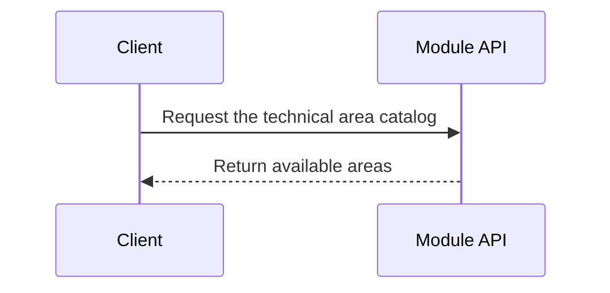

# Technical areas

The technical-area catalog supplies selectable areas for mentor registration and participation.

## Rules and dependencies

The backend serves catalog data and the mentorship flows consume it. The controller exposes a read endpoint.

## HTTP contract

- `GET /technical-areas`

## Main flow

## Sprint History

### Sprint 3

The technical-area catalog supplies selectable areas for mentor registration and participation.
