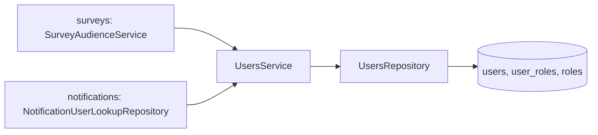
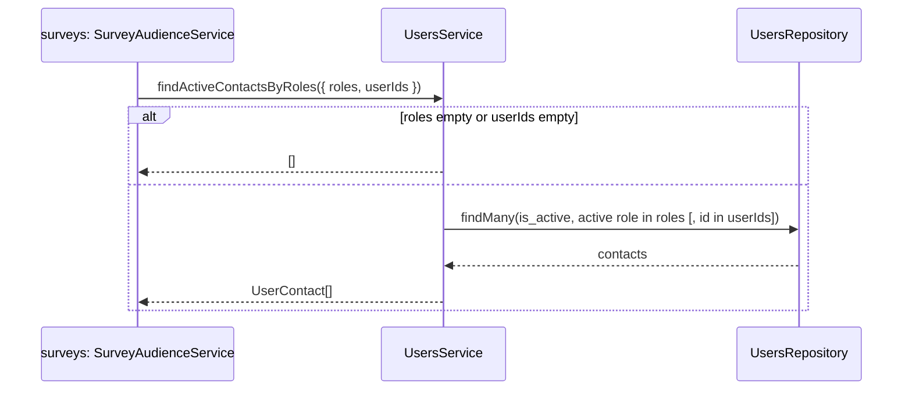
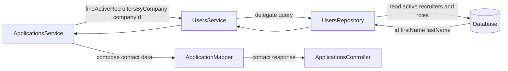
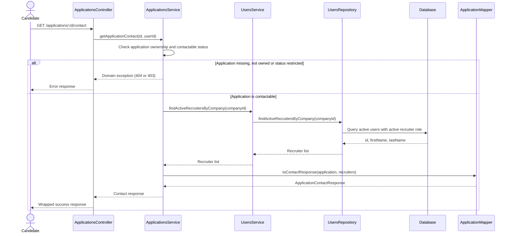

# Users

## Purpose

The `users` module owns the user accounts and exposes, through `UsersService`, the queries that other domains need about them. It has no HTTP controller of its own.

## Read services for other domains

| Method | Returns | Consumer |
| --- | --- | --- |
| `findContactById(userId)` | `UserContact` (`id`, `email`, `firstName`, `lastName`) or `null` | [notifications](../notifications/README.md) (`NotificationUserLookupRepository.findContactByUserId`, name and email of an email recipient) |
| `findActiveContactsByRoles({ roles, userIds? })` | `UserContact[]` of active users with any of those roles currently in effect, optionally limited to `userIds`, ordered by id | [surveys](../surveys/README.md) (`SurveyAudienceService`, eligible audience) |

## Business rules

- Only users with `is_active = true` and a role assignment without `deleted_at`.
- Empty `roles` or an explicitly empty `userIds` returns an empty list without querying the database; a missing `userIds` does not limit by id.
- `USER_CONTACT_SELECT` limits the returned data to id, email and name.

## Frontend integration

No direct consumption from the frontend. The contacts feed the pending count shown by `SendSurveyReminderDialog` and the greeting by name in notification emails.

## Dependencies

| Direction | Module | Use |
| --- | --- | --- |
| Used by | [surveys](../surveys/README.md) | Active contacts by role |
| Used by | [notifications](../notifications/README.md) | Email and name of the recipient |

## Data

Tables `users`, `user_roles` and `roles` (see [backend/prisma/README.md](../../backend/prisma/README.md)).

## Sprint History

### Sprint 3

#### Query of active recruiters by company

`UsersService.findActiveRecruitersByCompany(companyId)` was added to
query the active recruiters associated with a company. The service delegates
the query to `UsersRepository.findActiveRecruitersByCompany(companyId)`.

The query applies the following criteria:

- The user belongs to the company given by `companyId`.
- The user is active (`isActive: true`).
- The user has a non-deleted recruiter role (`deletedAt: null`).
- The role start date is earlier than or equal to the current date
  (`startAt <= new Date()`).

Only `id`, `firstName` and `lastName` are returned, sorted in
ascending order by first name, last name and identifier.

**Integration with Applications:** `ApplicationsService.getApplicationContact()`
uses this query to get the recruiters of the company associated
with an application and build the contact response.

#### Integration architecture

The Applications module obtains active company recruiters through the Users module.
The Users module owns recruiter membership and role selection; Applications does not
query those user records directly.

#### Recruiter lookup sequence

The recruiter query filters by `companyId`, `isActive: true`, a non-deleted role,
and a role start date not later than the current time. Results are sorted by
first name, last name, and ID. The existing Sprint 3 integration history above
is intentionally preserved.

This feature is an internal query between services; it does not add
a new HTTP endpoint to the Users module.

#### Contact queries for notifications and surveys

- `findContactById` and `findActiveContactsByRoles` with the `UserContact` type for the personalized notification emails and the survey audience.
