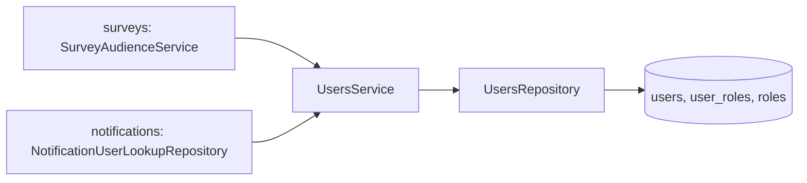
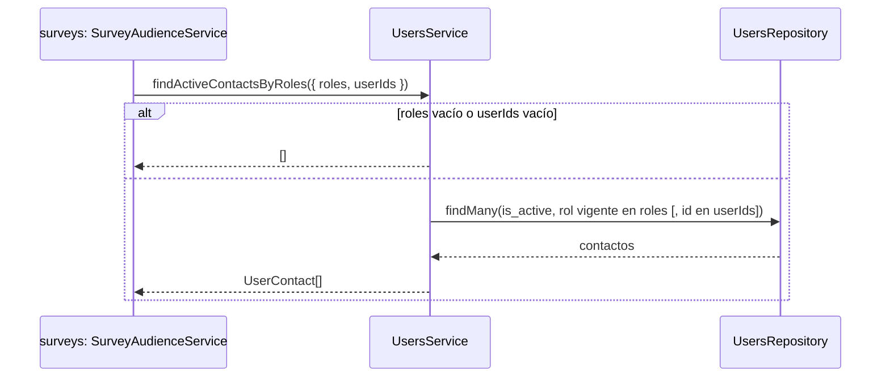

# Users (usuarios)

## Propósito

El módulo `users` es dueño de las cuentas de usuario y expone, mediante `UsersService`, las consultas que otros dominios necesitan sobre ellas. No tiene controlador HTTP propio.

## Servicios de lectura para otros dominios

| Método | Devuelve | Consumidor |
| --- | --- | --- |
| `findContactById(userId)` | `UserContact` (`id`, `email`, `firstName`, `lastName`) o `null` | [notifications](../notifications/README.md) (`NotificationUserLookupRepository.findContactByUserId`, nombre y correo del destinatario de un correo) |
| `findActiveContactsByRoles({ roles, userIds? })` | `UserContact[]` de usuarios activos con alguno de esos roles vigentes, opcionalmente limitado a `userIds`, ordenados por id | [surveys](../surveys/README.md) (`SurveyAudienceService`, audiencia elegible) |

## Reglas de negocio

- Solo usuarios con `is_active = true` y una asignación de rol sin `deleted_at`.
- `roles` vacío o `userIds` explícitamente vacío devuelve lista vacía sin consultar la base; `userIds` ausente no limita por id.
- `USER_CONTACT_SELECT` limita los datos devueltos a id, correo y nombre.

## Integración con el frontend

Sin consumo directo desde el frontend. Los contactos alimentan la cantidad de pendientes que muestra `SendSurveyReminderDialog` y el saludo con nombre de los correos de notificación.

## Dependencias

| Dirección | Módulo | Uso |
| --- | --- | --- |
| Usado por | [surveys](../surveys/README.md) | Contactos activos por rol |
| Usado por | [notifications](../notifications/README.md) | Correo y nombre del destinatario |

## Datos

Tablas `users`, `user_roles` y `roles` (ver [backend/prisma/README.md](../../backend/prisma/README.md)).

## Sprint History

### Sprint 3

#### Consulta de reclutadores activos por empresa

Se incorporó `UsersService.findActiveRecruitersByCompany(companyId)` para
consultar los reclutadores activos asociados a una empresa. El servicio delega
la consulta a `UsersRepository.findActiveRecruitersByCompany(companyId)`.

La consulta aplica los siguientes criterios:

- El usuario pertenece a la empresa indicada por `companyId`.
- El usuario está activo (`isActive: true`).
- El usuario tiene un rol de reclutador no eliminado (`deletedAt: null`).
- La fecha de inicio del rol es anterior o igual a la fecha actual
  (`startAt <= new Date()`).

Se devuelven únicamente `id`, `firstName` y `lastName`, ordenados de forma
ascendente por nombre, apellido e identificador.

**Integración con Postulaciones:** `ApplicationsService.getApplicationContact()`
utiliza esta consulta para obtener los reclutadores de la empresa asociada
a una postulación y construir la respuesta de contacto.

Esta funcionalidad es una consulta interna entre servicios; no incorpora
un endpoint HTTP nuevo en el módulo Users.

#### Consultas de contacto para notificaciones y encuestas

- `findContactById` y `findActiveContactsByRoles` con el tipo `UserContact` para los correos personalizados de notificaciones y la audiencia de encuestas.
