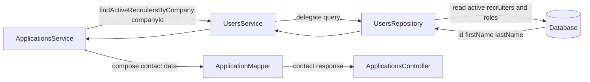
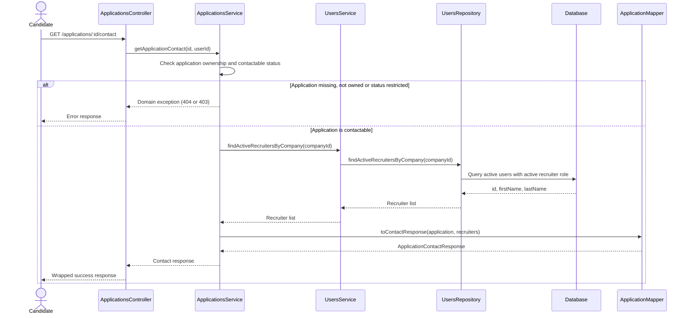

## Sprint History

### Sprint 3

#### Consulta de reclutadores activos por empresa

Se incorporó `UsersService.findActiveRecruitersByCompany(companyId)` para
consultar los reclutadores activos asociados a una empresa. El servicio delega
la consulta a `UsersRepository.findActiveRecruitersByCompany(companyId)`.

La consulta aplica los siguientes criterios:

- El usuario pertenece a la empresa indicada por `companyId`.
- El usuario está activo (`isActive: true`).
- El usuario tiene un rol de reclutador no eliminado (`deletedAt: null`).
- La fecha de inicio del rol es anterior o igual a la fecha actual
  (`startAt <= new Date()`).

Se devuelven únicamente `id`, `firstName` y `lastName`, ordenados de forma
ascendente por nombre, apellido e identificador.

**Integración con Postulaciones:** `ApplicationsService.getApplicationContact()`
utiliza esta consulta para obtener los reclutadores de la empresa asociada
a una postulación y construir la respuesta de contacto.

Esta funcionalidad es una consulta interna entre servicios; no incorpora
un endpoint HTTP nuevo en el módulo Users.

#### Integration architecture

The Applications module obtains active company recruiters through the Users module.
The Users module owns recruiter membership and role selection; Applications does not
query those user records directly.

#### Recruiter lookup sequence

The recruiter query filters by `companyId`, `isActive: true`, a non-deleted role,
and a role start date not later than the current time. Results are sorted by
first name, last name, and ID. The existing Sprint 3 integration history above
is intentionally preserved.
