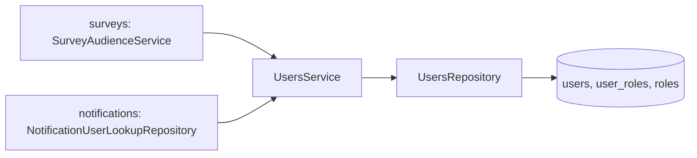
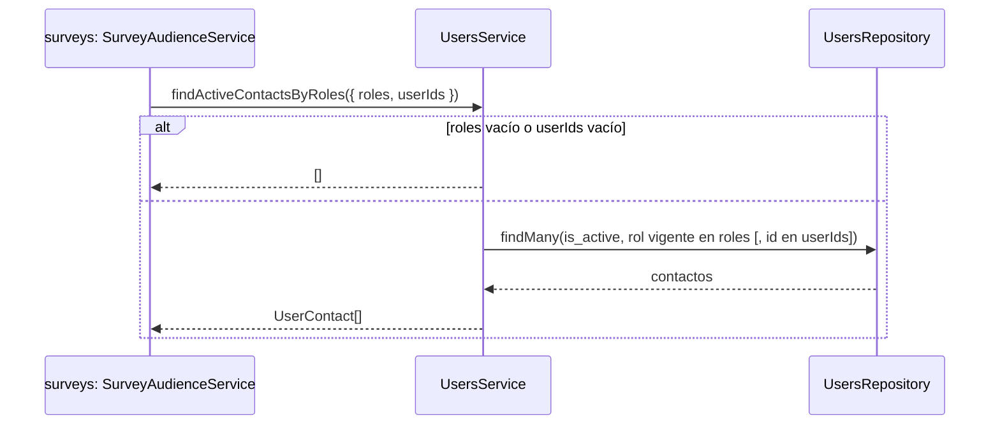

# Users (usuarios)

## Propósito

El módulo `users` es dueño de las cuentas de usuario y expone, mediante `UsersService`, las consultas que otros dominios necesitan sobre ellas. No tiene controlador HTTP propio.

Este documento describe las consultas de contacto añadidas en el Sprint 3.

## Servicios de lectura para otros dominios

| Método | Devuelve | Consumidor |
| --- | --- | --- |
| `findContactById(userId)` | `UserContact` (`id`, `email`, `firstName`, `lastName`) o `null` | [notifications](../notifications/README.md) (`NotificationUserLookupRepository.findContactByUserId`, nombre y correo del destinatario de un correo) |
| `findActiveContactsByRoles({ roles, userIds? })` | `UserContact[]` de usuarios activos con alguno de esos roles vigentes, opcionalmente limitado a `userIds`, ordenados por id | [surveys](../surveys/README.md) (`SurveyAudienceService`, audiencia elegible) |

## Reglas de negocio

- Solo usuarios con `is_active = true` y una asignación de rol sin `deleted_at`.
- `roles` vacío o `userIds` explícitamente vacío devuelve lista vacía sin consultar la base; `userIds` ausente no limita por id.
- `USER_CONTACT_SELECT` limita los datos devueltos a id, correo y nombre.

## Dependencias

| Dirección | Módulo | Uso |
| --- | --- | --- |
| Usado por | [surveys](../surveys/README.md) | Contactos activos por rol |
| Usado por | [notifications](../notifications/README.md) | Correo y nombre del destinatario |

## Datos

Tablas `users`, `user_roles` y `roles` (ver [backend/prisma/README.md](../../backend/prisma/README.md)).

## Sprint History

### Sprint 3

- `findContactById` y `findActiveContactsByRoles` con el tipo `UserContact` para los correos personalizados de notificaciones y la audiencia de encuestas.
