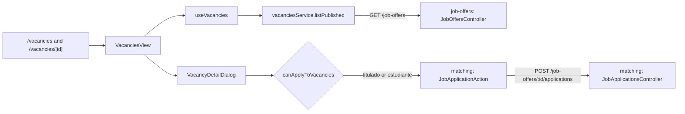
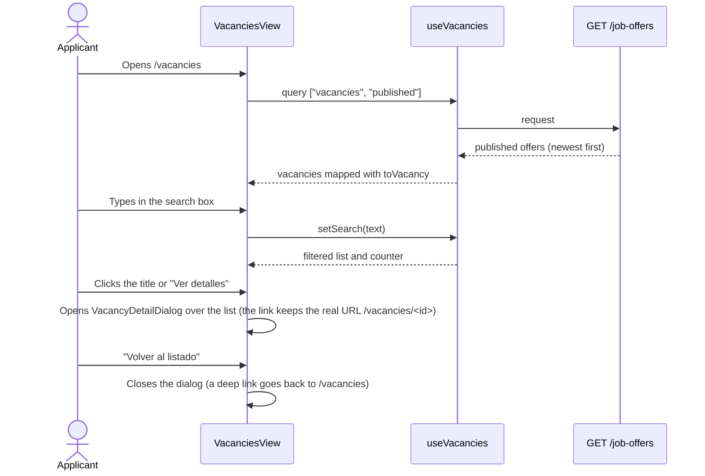

# Vacancies

## Purpose

Public-facing catalog of open job vacancies for graduates and students ("Todas las vacantes"). A person can browse every published vacancy, search it, open the full detail and apply from there.

This is a **frontend-only module**: there is no `backend/src/modules/vacancies`. The data comes from the published job offers of the [job-offers](../job-offers/README.md) module, and the application itself is created by [matching](../matching/README.md).

Owner: group 5.

## Functionality

| Feature                                                                          | Where                                                         |
| -------------------------------------------------------------------------------- | ------------------------------------------------------------- |
| List all published, not expired vacancies as cards                               | `GET /job-offers`, `/vacancies`                               |
| Search by title, company, description, modality, contract type or required skill | Client-side filter                                            |
| Counter of found vacancies and empty states (no vacancies, no results)           | `VacanciesView`                                               |
| Vacancy detail with conditions, description and required technologies            | Dialog on `/vacancies/[id]` (deep link)                       |
| Publication and expiry dates of every vacancy                                    | Date badges and detail                                        |
| Apply from the detail                                                            | `JobApplicationAction` from [matching](../matching/README.md) |

## Architecture

## Key flows

### Browse, search and open a vacancy

## Business rules

- Only vacancies with status `Publicada` that have not expired are returned by the API, ordered by publication date (newest first). The frontend does not filter dates again.
- The search is case-insensitive and looks into title, company, description, modality, contract type and the required skills.
- A normal click on a card opens the detail as a dialog over the list without leaving the page. Each card keeps a real link to `/vacancies/<id>`: opening it directly (or in a new tab, or with a modifier key) shows the same dialog, and closing it returns to `/vacancies`. An id that is not in the list shows "Vacante no encontrada" and lets the person go back.
- The apply button appears only for sessions whose role is `titulado` or `estudiante`. Other roles can read the catalog but cannot apply.
- A vacancy without expiry date shows "Sin fecha de expiración". All dates are shown in Bolivia time.
- Required skills are shown as light blue chips (availability tokens) in the card and as a list in the detail.
- The location link is shown only when it is a valid Google Maps URL.
- Layout: single column on mobile, with the dates and "Ver detalles" in their own row, and three columns from the `md` breakpoint.

## Endpoints

This module defines no endpoints. It consumes:

| Method | Path                              | Owner                                 | Use                                     |
| ------ | --------------------------------- | ------------------------------------- | --------------------------------------- |
| GET    | `/job-offers`                     | [job-offers](../job-offers/README.md) | Published vacancies                     |
| POST   | `/job-offers/:id/applications`    | [matching](../matching/README.md)     | Apply from the detail                   |
| GET    | `/job-offers/:id/applications/me` | [matching](../matching/README.md)     | Show whether the person already applied |

## Dependencies

| Direction | Module       | Use                                                           |
| --------- | ------------ | ------------------------------------------------------------- |
| Uses      | job-offers   | Source of the published vacancies                             |
| Uses      | matching     | `JobApplicationAction` and the application endpoints          |
| Uses      | auth         | `getSessionRoles` to decide whether the apply button is shown |
| Used by   | applications | The empty state of "Mis postulaciones" links to `/vacancies`  |

## Data

No tables of its own. See `job_offers` and its relations in [backend/prisma/README.md](../../backend/prisma/README.md).

## Design decisions

- **No separate backend module.** A vacancy is a job offer; creating another backend module would duplicate it. The `vacancies` name exists only on the applicant side of the UI, while `job-offers` is the company side.
- **Search in the client.** The published list is small and already loaded, so filtering locally gives instant results without a new endpoint.
- **The detail is a dialog backed by a real URL**, so it can be shared or opened in a new tab, while a normal click keeps the person in the list with their search intact.
- **The apply action lives in matching** so the consents, the duplicate protection and the confirmation are the same wherever the person applies (list, detail or recommended feed).

## Sprint History

### Sprint 3

- "Todas las vacantes" list with search, counter, empty states and responsive layout.
- Vacancy detail dialog with conditions, description and required technologies, reachable by URL.
- Publication and expiry dates on every vacancy, in Bolivia time.
- Required skills shown as chips with the availability color tokens.
- Apply from the detail for graduates and students.
