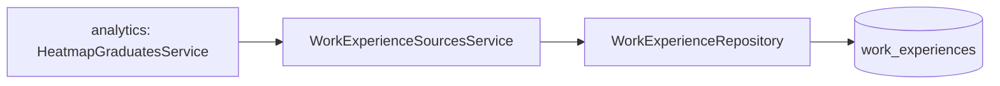
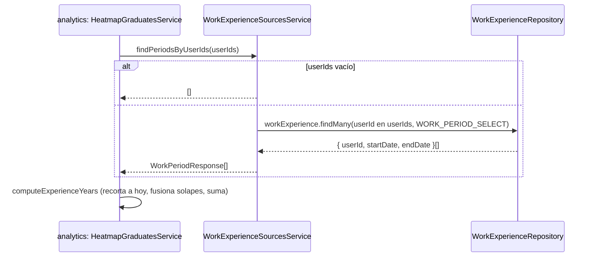

# Work Experience (experiencia laboral)

## Propósito

El módulo `work-experience` gestiona las experiencias laborales del perfil de cada persona. `WorkExperienceSourcesModule` expone a otros dominios las lecturas de esas experiencias sin dar acceso directo a la tabla.

Este documento describe la consulta de periodos laborales añadida en el Sprint 3.

## Servicios de lectura para otros dominios

`WorkExperienceSourcesService` (exportado por `WorkExperienceSourcesModule`):

| Método | Devuelve | Consumidor |
| --- | --- | --- |
| `findPeriodsByUserIds(userIds)` | `WorkPeriodResponse[]` (`userId`, `startDate`, `endDate` nulo si sigue vigente). Con lista vacía no consulta la base | [analytics](../analytics/README.md) (años de experiencia en el mapa de habilidades vs. experiencia) |

## Reglas de negocio

- Solo se exponen las fechas de inicio y fin de cada experiencia (`WORK_PERIOD_SELECT`); no se exponen empresa, cargo ni descripción.
- El cálculo de años de experiencia es responsabilidad del consumidor.
- Solo lectura; no tiene endpoint HTTP propio.

## Dependencias

| Dirección | Módulo | Uso |
| --- | --- | --- |
| Usado por | [analytics](../analytics/README.md) | Periodos laborales por titulado |

## Datos

Tabla `work_experiences` (ver [backend/prisma/README.md](../../backend/prisma/README.md)).

## Sprint History

### Sprint 3

- `WorkExperienceSourcesService.findPeriodsByUserIds` y el contrato `WorkPeriodResponse` para los mapas de calor.
