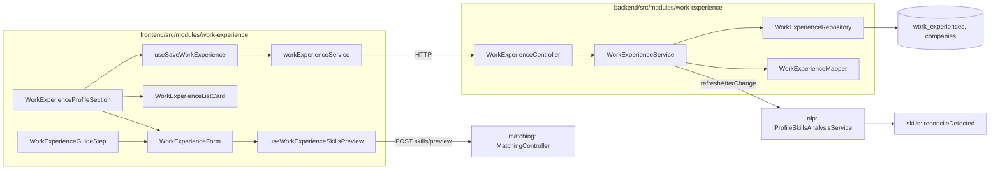
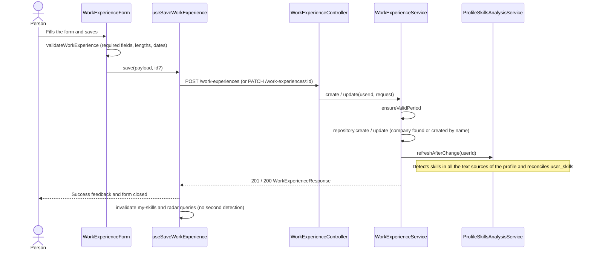
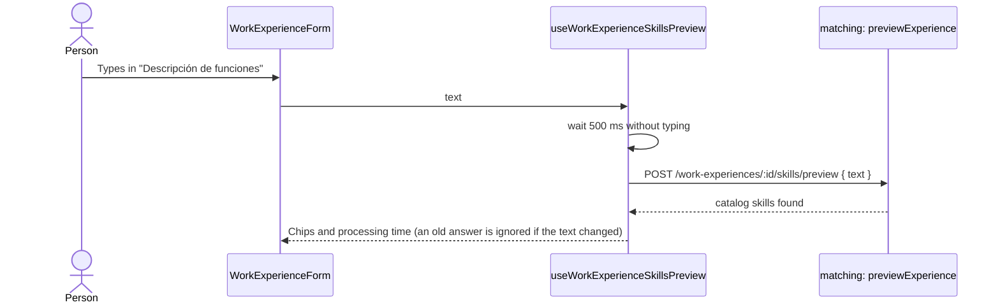
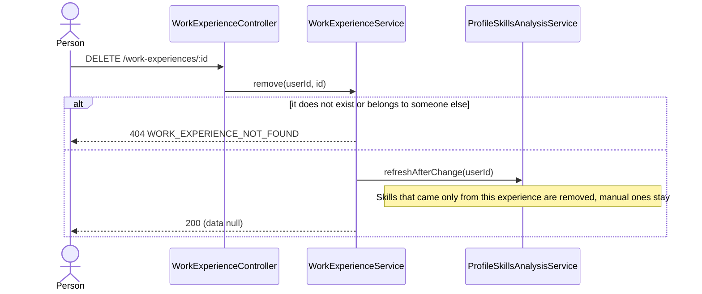
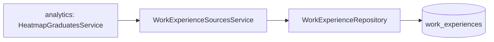
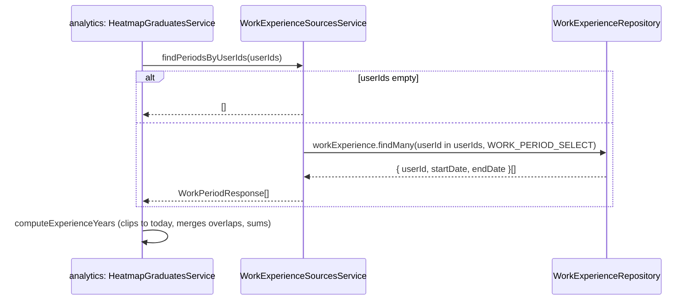

# Work experience

## Purpose

Lets a person register the jobs they have held (company, position, period and a description of their duties) as part of their profile. The description is also the main source from which the platform detects the person's skills, so saving, editing or deleting an experience keeps the skills of the profile up to date.

The text analysis that turns descriptions into skills is shared with the [matching](../matching/README.md) and [skills](../skills/README.md) modules and with the `nlp` module, which is owned by another team.

## Functionality

| Feature                                                                            | Where                                                         |
| ---------------------------------------------------------------------------------- | ------------------------------------------------------------- |
| List, create, edit and delete my work experiences                                  | `/work-experiences` endpoints, profile page and profile guide |
| Group experiences by company, with all groups collapsible and collapsed by default | `WorkExperienceListCard`                                      |
| Live skill suggestions while typing the description                                | `POST /work-experiences/:id/skills/preview`                   |
| Skills of the profile refreshed after every change                                 | `ProfileSkillsAnalysisService.refreshAfterChange`             |
| Light blue chips showing the skills that come from each experience                 | `skillsByExperience`                                          |

## Architecture

## Key flows

### Save an experience

### Live suggestions while typing

### Delete an experience

## Business rules

- All data belongs to the signed-in user; reading, editing or deleting another person's experience answers 404.
- Required fields: company name (max 100 characters), position (max 150), start date and description (max 5000, trimmed, not empty). The backend trims the description and stores it as typed, preserving the capitalization of acronyms and proper names (for example, `APIs` and `Node.js`).
- Dates must be between 1 January 1950 and today (Bolivia time `America/La_Paz`).
- If `isCurrent` is true the end date is cleared. If it is false, the end date is required (`WORK_EXPERIENCE_END_DATE_REQUIRED`) and cannot be earlier than the start date (`INVALID_WORK_EXPERIENCE_DATE_RANGE`). Both answer 400.
- An update that finds the dates changed by someone else during the operation answers 409 `WORK_EXPERIENCE_UPDATE_CONFLICT`.
- The company is a row of `companies`: it is found by its exact name or created. The same table holds the companies that publish vacancies, so an experience at a company that later publishes vacancies points to the same row.
- Every create, update and delete awaits `refreshAfterChange`. The detection result is already stored when the response arrives, so the client does not ask for it again; it only refreshes the skill queries. A failure of the detection is logged and never fails the save.
- In the client, experiences are ordered with the current job first and then by start date, newest first. They are grouped by company name ignoring case and extra spaces. Every company group is collapsible, including groups with a single position. All groups start collapsed, and each group opens and closes independently.
- After saving, a status line says that the skills are being refreshed in the background and the person can continue with the profile (the guide does not wait for it).

## Endpoints

All endpoints require a valid JWT (any role).

| Method | Path                    | Description                                                                                                 | Success                        | Errors                                                                      |
| ------ | ----------------------- | ----------------------------------------------------------------------------------------------------------- | ------------------------------ | --------------------------------------------------------------------------- |
| GET    | `/work-experiences`     | Own experiences                                                                                             | 200 `WorkExperienceResponse[]` | 401                                                                         |
| POST   | `/work-experiences`     | Creates an experience. Body: `companyName`, `position`, `startDate`, `endDate?`, `isCurrent`, `description` | 201 `WorkExperienceResponse`   | 400 validation, date range or end date required                             |
| PATCH  | `/work-experiences/:id` | Updates any of the fields                                                                                   | 200 `WorkExperienceResponse`   | 400, 404 `WORK_EXPERIENCE_NOT_FOUND`, 409 `WORK_EXPERIENCE_UPDATE_CONFLICT` |
| DELETE | `/work-experiences/:id` | Deletes it                                                                                                  | 200 (data null)                | 404 `WORK_EXPERIENCE_NOT_FOUND`                                             |

`WorkExperienceResponse`: `id`, `companyName`, `position`, `startDate` and `endDate` (`YYYY-MM-DD`), `isCurrent`, `description`, `createdAt`, `updatedAt`.

The suggestions use `POST /work-experiences/:id/skills/preview` and `/analysis`, which belong to [matching](../matching/README.md).

## Dependencies

| Direction | Module                            | Use                                                                               |
| --------- | --------------------------------- | --------------------------------------------------------------------------------- |
| Uses      | nlp                               | `ProfileSkillsAnalysisService.refreshAfterChange` after every change              |
| Uses      | [matching](../matching/README.md) | Skill preview endpoint (frontend)                                                 |
| Uses      | [skills](../skills/README.md)     | Query keys to refresh the profile skills (frontend)                               |
| Uses      | profile                           | Profile completeness refresh and feedback components (frontend)                   |
| Used by   | [matching](../matching/README.md) | `WorkExperienceService.findAll` to compute the years of experience of a candidate |
| Used by   | nlp, skills                       | Experience text is one of the sources of detection                                |

## Data

Table `work_experiences`, related to `users` and `companies` (see [backend/prisma/README.md](../../backend/prisma/README.md)).

## Frontend

- Components: `WorkExperienceProfileSection` (profile page), `WorkExperienceGuideStep` (profile completion guide), `WorkExperienceForm`, `WorkExperienceListCard`.
- Hooks: `useWorkExperiences`, `useSaveWorkExperience`, `useDeleteWorkExperience`, `useWorkExperienceSkillsPreview`.
- Delete asks for confirmation; there are loading, empty and error states, and the form warns about unsaved changes through the guide.

## Design decisions

- **The backend detects, the frontend only refreshes.** The detection runs inside the create, update and delete requests, so the saved result and the screen never disagree and the client does not repeat the analysis.
- **Preview and persisted analysis are different calls.** Typing only previews; nothing is stored until the experience is saved.
- **Skills come from evidence, not from a flag on the experience.** When an experience is removed, the skills that came only from it disappear and manual skills remain (see [skills](../skills/README.md)).
- **Companies are shared rows** so work history and vacancies refer to the same company record.
- **Consistent company grouping.** The accordion control is rendered for every company group, even if it contains only one position. All groups start collapsed (`expandedGroups[groupId] ?? false`) and can be opened independently to keep long histories short.
- **The save does not wait for the skills refresh**, so the guide can continue immediately.

## Read services for other domains

The `work-experience` module manages the work experiences of each person's profile. `WorkExperienceSourcesModule` exposes reads of those experiences to other domains without giving direct access to the table.

`WorkExperienceSourcesService` (exported by `WorkExperienceSourcesModule`):

| Method                          | Returns                                                                                                                            | Consumer                                                                                   |
| ------------------------------- | ---------------------------------------------------------------------------------------------------------------------------------- | ------------------------------------------------------------------------------------------ |
| `findPeriodsByUserIds(userIds)` | `WorkPeriodResponse[]` (`userId`, `startDate`, `endDate` null if still ongoing). With an empty list it does not query the database | [analytics](../analytics/README.md) (years of experience in the skills vs. experience map) |

### Read rules

- Only the start and end dates of each experience are exposed (`WORK_PERIOD_SELECT`); company, position and description are not exposed.
- Computing the years of experience is the consumer's responsibility.
- Read only; it has no HTTP endpoint of its own.

### Read dependencies

| Direction | Module                              | Use                       |
| --------- | ----------------------------------- | ------------------------- |
| Used by   | [analytics](../analytics/README.md) | Work periods per graduate |

### Read frontend integration

The frontend does not call this service; its data is shown in the backoffice heatmaps (`frontend/src/modules/heatmaps`, `/backoffice/reports/heatmaps/*`).

## Action styling

The record editor uses the outlined Cancel action. Deleting saved experience remains a distinct destructive action.

## Sprint History

### Sprint 3

- Register, edit and delete work experience with validation of dates and lengths.
- Experiences grouped by company, collapsed by default, with independent groups and a header that grows with its content.
- Live skill suggestions while typing the description, with debounce and stale-answer protection.
- Skills of the profile refreshed after each change, including cleanup when an experience is deleted.
- Skill chips of each experience in light blue.
- `WorkExperienceSourcesService.findPeriodsByUserIds` and the `WorkPeriodResponse` contract for the heatmaps.
